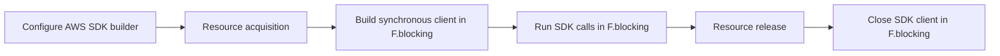

# AWS client utilities

The AWS module wraps selected AWS SDK for Java v2 synchronous clients in Cats Effect. Each service
constructor returns a `Resource`, shifts blocking SDK calls to the blocking pool, logs initialization,
operation failures, and shutdown, and exposes the underlying AWS request and response models.

Supported services and helpers:

- AppConfig data-plane polling
- CloudWatch metrics
- Systems Manager Parameter Store
- Secrets Manager
- Simple Email Service (SES)
- Simple Notification Service (SNS)
- Simple Queue Service (SQS)
- Simple Storage Service (S3)
- ECS container metadata
- CloudWatch Logs console links
- S3 event parsing from direct SQS notifications

## Contents

- [Dependency](#dependency)
- [Client configuration](#client-configuration)
  - [Production configuration](#production-configuration)
  - [Endpoint overrides](#endpoint-overrides)
  - [Lifecycle and failure behavior](#lifecycle-and-failure-behavior)
- [Service reference](#service-reference)
- [Configuration and secret retrieval](#configuration-and-secret-retrieval)
  - [Parameter Store](#parameter-store)
  - [Secrets Manager](#secrets-manager)
  - [AppConfig](#appconfig)
- [Messaging](#messaging)
  - [SNS](#sns)
  - [SQS](#sqs)
  - [S3 event notifications](#s3-event-notifications)
  - [SES](#ses)
- [S3](#s3)
- [CloudWatch](#cloudwatch)
- [ECS metadata and log links](#ecs-metadata-and-log-links)
- [Data types](#data-types)
- [Wire format](#wire-format)
- [Security and operational guidance](#security-and-operational-guidance)
- [Source map and validation](#source-map-and-validation)

## Dependency

Add the module:

```scala
libraryDependencies += "com.github.chenharryhua" %% "nj-aws" % "<version>"
```

The module includes the required AWS SDK service clients. Applications still choose the credential
provider, region, endpoint, HTTP transport, SDK retry strategy, and timeout configuration.

## Client configuration

Every wrapper accepts a function that transforms the corresponding AWS SDK builder. The wrapper does
not replace the SDK's credential or region provider chains; omitting explicit values leaves resolution
to the AWS SDK and environment.

### Production configuration

```scala
import cats.effect.{IO, Resource}
import com.github.chenharryhua.nanjin.aws.SecretsManager
import software.amazon.awssdk.auth.credentials.DefaultCredentialsProvider
import software.amazon.awssdk.regions.Region

val secrets: Resource[IO, SecretsManager[IO]] =
  SecretsManager[IO](
    _.region(Region.AP_SOUTHEAST_2)
      .credentialsProvider(DefaultCredentialsProvider.create())
  )
```

Prefer the default credential chain, workload identities, ECS task roles, or EC2 instance profiles to
long-lived static access keys. The builder also accepts AWS SDK `ClientOverrideConfiguration` for
attempt timeouts, call timeouts, and retry strategy.

### Endpoint overrides

Endpoint overrides support local emulators, test transports, and private endpoints:

```scala
import java.net.URI

val localSecrets: Resource[IO, SecretsManager[IO]] =
  SecretsManager[IO](
    _.region(Region.US_EAST_1)
      .endpointOverride(URI.create("http://localhost:4566"))
  )
```

An endpoint override does not remove the SDK's region or credential requirements. Local environments
usually need a region and a credential provider even when the emulator ignores signatures. S3
emulators may also require `forcePathStyle(true)`.

### Lifecycle and failure behavior



All public client constructors own the SDK client they build. Releasing the resource closes it.
Shutdown failures are logged as warnings and are not re-raised. SDK operation failures are logged
with operation context and then propagated to the caller.

The wrappers do not add a second retry or timeout layer. Configure those policies on the AWS client
builder. AppConfig and SQS have application-level polling policies described below; those policies do
not replace SDK transport retries.

## Service reference

| Wrapper | AWS client | Main operations |
| --- | --- | --- |
| `AppConfig[F]` | `AppConfigDataClient` | Start a session and continuously refresh its latest response |
| `CloudWatch[F]` | `CloudWatchClient` | `PutMetricData` |
| `ParameterStore[F]` | `SsmClient` | Fetch one or more parameters and Base64-decode a value |
| `SecretsManager[F]` | `SecretsManagerClient` | Fetch raw, string, or binary secrets |
| `SimpleEmailService[F]` | `SesClient` | Send structured HTML or raw email |
| `SimpleNotificationService[F]` | `SnsClient` | Publish messages |
| `SimpleQueueService[F]` | `SqsClient` | Poll, send, delete, and reset message visibility |
| `SimpleStorageService[F]` | `S3Client` and `S3Presigner` | Download, upload, inspect, copy, rename, delete, and presign objects |

Most operations accept either a fully built AWS request or a builder transformation:

```scala
service.operation(request)
service.operation(_.field(value))
```

The AWS SDK performs request validation when the request is built or sent.

## Configuration and secret retrieval

### Parameter Store

`ParameterStore.fetch(path)` requests decryption by default and returns `ParameterStoreContent`:

```scala
import com.github.chenharryhua.nanjin.aws.ParameterStore

val parameters =
  ParameterStore[IO](_.region(Region.AP_SOUTHEAST_2))

val databasePassword: IO[String] =
  parameters.use(
    _.fetch("/orders/production/database-password").map(_.value)
  )

val certificateBytes: IO[Array[Byte]] =
  parameters.use(
    _.base64("/orders/production/certificate")
  )
```

Pass `isSecure = false` to skip decryption for a normal `String` parameter. The raw `fetch(request)`
overload supports multiple names and returns the AWS `GetParametersResponse`. The convenience
single-path method selects the first returned parameter and raises `NoSuchElementException` when AWS
returns none. `base64` applies the standard Base64 decoder to the fetched value.

### Secrets Manager

```scala
val apiToken: IO[String] =
  secrets.use(_.getString("orders/api-token"))

val binaryKey: IO[Array[Byte]] =
  secrets.use(
    _.getBinary("orders/binary-key").map(_.asByteArray())
  )
```

`getValue` returns the complete AWS `GetSecretValueResponse`. `getString` fails with guidance to use
`getBinary` when `SecretString` is absent; `getBinary` fails with guidance to use `getString` when
`SecretBinary` is absent. The wrapper does not parse JSON secret strings.

### AppConfig

`AppConfig.latest` performs the AppConfig data-plane token handshake and starts one background poller.
The resource yields an effect that reads the most recent response:

```scala
import com.github.chenharryhua.nanjin.aws.AppConfig

import java.nio.charset.StandardCharsets

val appConfig =
  AppConfig[IO](_.region(Region.AP_SOUTHEAST_2))

val readCurrentConfig: IO[String] =
  appConfig.use { client =>
    client
      .latest(
        _.applicationIdentifier("orders")
          .environmentIdentifier("production")
          .configurationProfileIdentifier("runtime")
      )
      .use { current =>
        current.map(
          _.configuration().asString(StandardCharsets.UTF_8)
        )
      }
  }
```

Acquisition starts a configuration session and immediately calls `GetLatestConfiguration` with the
initial token. Every response supplies the token for the next request and the requested polling
interval. The poller waits that interval, fetches the next value, and updates the shared response. If
AWS omits the interval, the poller waits 60 seconds; if it omits the next token, the wrapper uses an
empty token.

AppConfig tokens are single-use and are never reused by the poller. Releasing the `latest` resource
cancels its background fiber. A poll failure ends that background refresh; the read effect continues
to expose the last successfully stored response. Configure SDK retries and external monitoring when
continued refresh is required.

## Messaging

### SNS

```scala
import com.github.chenharryhua.nanjin.aws.SimpleNotificationService

val sns =
  SimpleNotificationService[IO](_.region(Region.AP_SOUTHEAST_2))

val publish =
  sns.use(
    _.publish(
      _.topicArn("arn:aws:sns:ap-southeast-2:123456789012:orders")
        .subject("Order created")
        .message("{\"orderId\":\"123\"}")
    )
  )
```

The wrapper performs one AWS `Publish` call and returns the SDK `PublishResponse`. Message structure,
FIFO fields, attributes, deduplication, and retry behavior remain available through the AWS request
builder.

### SQS

`SimpleQueueService` takes a time zone and a `Policy` that controls re-polling after an empty receive:

```scala
import cats.syntax.all.*
import com.github.chenharryhua.nanjin.aws.SimpleQueueService

import java.time.ZoneId
import scala.concurrent.duration.*

val queueUrl = "https://sqs.ap-southeast-2.amazonaws.com/123456789012/orders"

val sqs =
  SimpleQueueService[IO](
    ZoneId.of("Australia/Sydney"),
    _.fixedDelay(1.second).repeat
  )(
    _.region(Region.AP_SOUTHEAST_2)
  )

def handle(body: String): IO[Unit] = IO.println(body)

val consumeQueue: IO[Unit] =
  sqs.use { queue =>
    queue
      .receive(
        _.queueUrl(queueUrl)
          .maxNumberOfMessages(10)
          .waitTimeSeconds(20)
      )
      .evalMap { message =>
        handle(message.response.body()) >> queue.delete(message).void
      }
      .compile
      .drain
  }
```

A non-empty response is emitted immediately and resets the empty-poll policy. An empty response
advances the policy, sleeps for its `snooze`, and polls again. When the policy is exhausted, the
stream completes. `Policy.empty` therefore stops on the first empty response. AWS long polling is
configured separately through `waitTimeSeconds`.

Messages are not deleted automatically. Delete only after processing succeeds. `resetVisibility`
sets the message visibility timeout to zero, making the message available for redelivery. `send`
accepts a `SendMessageRequest` or builder transformation.

`SqsMessage` includes the receive request, raw AWS message, 1-based batch and message indexes, and the
batch size. The batch index advances only after a non-empty response.

### S3 event notifications

`sqsS3Parser` extracts direct S3 event notifications from an `SqsMessage` body:

```scala
import com.github.chenharryhua.nanjin.aws.sqsS3Parser

val files = sqsS3Parser(message)
files.foreach(file => println(s"${file.path.url} (${file.size} bytes)"))
```

The parser reads `Records[*].s3.bucket.name`, `Records[*].s3.object.key`, and
`Records[*].s3.object.size`. Object keys are URL-decoded as UTF-8. Invalid JSON, non-S3 messages,
missing fields, and records with invalid field types are ignored, so the result can be empty.
Malformed percent escapes in object keys throw `IllegalArgumentException` instead of being ignored.

The parser expects the S3 event JSON directly in the SQS body. It does not unwrap an SNS notification
envelope whose `Message` field contains the S3 event.

### SES

`EmailContent` builds one UTF-8 HTML email. Primary recipients are non-empty; duplicate addresses
are removed within each of the `to`, `cc`, and `bcc` recipient lists before sending:

```scala
import cats.data.NonEmptyList
import com.github.chenharryhua.nanjin.aws.{Email, EmailContent, SimpleEmailService}

val email = EmailContent(
  from = Email("orders@example.com"),
  to = NonEmptyList.one(Email("operator@example.com")),
  subject = "Order processing failed",
  body = "<p>Order 123 could not be processed.</p>"
)

val sendEmail =
  SimpleEmailService[IO](_.region(Region.AP_SOUTHEAST_2))
    .use(_.send(email))
```

For text bodies, attachments, multipart content, or custom MIME headers, construct a
`SendRawEmailRequest`. The wrapper also accepts a complete `SendEmailRequest` or its builder.

## S3

`SimpleStorageService` manages both an `S3Client` and a matching `S3Presigner`:

```scala
import com.github.chenharryhua.nanjin.aws.SimpleStorageService
import software.amazon.awssdk.core.sync.RequestBody

val s3 =
  SimpleStorageService[IO](_.region(Region.AP_SOUTHEAST_2))

val upload =
  s3.use(
    _.putObject(
      RequestBody.fromString("payload"),
      _.bucket("orders-data").key("events/123.json")
    )
  )

val download: IO[Array[Byte]] =
  s3.use { client =>
    client
      .getObject(_.bucket("orders-data").key("events/123.json"))
      .use(stream => IO.blocking(stream.readAllBytes()))
  }
```

`getObject` is a nested `Resource` because the AWS response stream must be closed independently of
the S3 client. Read it inside `use`; do not return the stream beyond that scope.

Other operations:

| API | Behavior |
| --- | --- |
| `headObject` | Reads metadata without downloading the object |
| `copyObject` | Server-side copy described by the AWS request |
| `deleteObject` | Permanently deletes an object version selected by the request |
| `renameObject` | Uses the S3 rename API for S3 Express One Zone directory buckets |
| `presignGetObject` | Creates a signed GET request locally |

Standard S3 buckets do not support the rename API. Use copy followed by delete when that non-atomic
behavior is acceptable.

The convenience presigner accepts an `s3://bucket/key` string and defaults to 30 minutes:

```scala
import scala.concurrent.duration.*

val signed =
  s3.use(_.presignGetObject("s3://orders-data/events/123.json", 10.minutes))
```

It uses the URI host as the bucket and the path without its leading slash as the key. The presigner
inherits the S3 client's region, credentials provider, and endpoint override. Creating a presigned
request does not contact S3.

## CloudWatch

```scala
import com.github.chenharryhua.nanjin.aws.CloudWatch
import software.amazon.awssdk.services.cloudwatch.model.{Dimension, MetricDatum, StandardUnit}

val metric =
  MetricDatum
    .builder()
    .metricName("OrdersProcessed")
    .unit(StandardUnit.COUNT)
    .value(1.0)
    .dimensions(
      Dimension.builder().name("Environment").value("production").build()
    )
    .build()

val putMetric =
  CloudWatch[IO](_.region(Region.AP_SOUTHEAST_2))
    .use(
      _.putMetricData(
        _.namespace("Orders")
          .metricData(metric)
      )
    )
```

The wrapper sends one `PutMetricDataRequest`. Namespace, metric, and dimension names are caller-owned
CloudWatch wire identifiers; changing them creates different CloudWatch series.

## ECS metadata and log links

`ecs.containerMetadata` checks `ECS_CONTAINER_METADATA_URI_V4`, then
`ECS_CONTAINER_METADATA_URI`. `ecs.containerMetadataTask` appends `/task` to the selected endpoint.
Both return `F[Option[Json]]`:

```scala
import com.github.chenharryhua.nanjin.aws.ecs

val container = ecs.containerMetadata[IO]
val task = ecs.containerMetadataTask[IO]
```

A missing or malformed environment URI produces `None`. An HTTP or JSON failure also produces
`None`, allowing the same application to run outside ECS without failing startup.

`CloudWatchLogLocator` reads the container metadata `LogOptions` fields written by the ECS `awslogs`
driver and builds links into the CloudWatch Logs console:

```scala
import com.github.chenharryhua.nanjin.aws.CloudWatchLogLocator

val locator = CloudWatchLogLocator[IO](5.minutes)
```

It requires `awslogs-group`, `awslogs-region`, and `awslogs-stream`. Missing metadata or fields yield
`None` and a warning. `locate(timestamp)` adds a time range from `timestamp - window` to
`timestamp + window` in epoch milliseconds.

When the Guard module is also present, the locator effect can be supplied through
`ServiceConfig.withLogLocator` so lifecycle, metrics, and reported events carry backend links.

## Data types

| Type | Representation and behavior |
| --- | --- |
| `Email` | Opaque string for an email address |
| `IamArn` | Opaque string for an IAM ARN |
| `SnsArn` | Opaque string for an SNS ARN |
| `KmsArn` | Opaque string for a KMS ARN |
| `ParameterStoreContent` | Opaque string returned by Parameter Store |
| `SqsUrl.Standard` | Opaque string for a standard queue URL |
| `SqsUrl.Fifo` | Opaque string for a FIFO queue URL |
| `EmailContent` | Structured sender, recipients, subject, and HTML body |
| `sqsS3Parser.S3Path` | S3 bucket and decoded key, with an `s3://` URL view |
| `sqsS3Parser.SqsS3File` | Parsed S3 path, size, SQS message id, and queue URL |

The opaque wrappers provide type separation but do not validate syntax. AWS validates identifiers
when requests are sent. Their `Show` and JSON representations are the underlying strings; do not log
values that contain sensitive content.

## Wire format

The module primarily delegates AWS request and response wire formats to the AWS SDK. The following
library-owned serialized names are stable contracts:

| Value | JSON fields or representation |
| --- | --- |
| `Email`, `IamArn`, `SnsArn`, `KmsArn`, `ParameterStoreContent`, `SqsUrl.Standard`, `SqsUrl.Fifo` | JSON string |
| `EmailContent` | `from`, `to`, `subject`, `body`, `cc`, `bcc` |
| `SqsMessage.asJson` | `batchIndex`, `messageIndex`, `batchSize` |
| `sqsS3Parser.S3Path` | `bucket`, `key` |
| `sqsS3Parser.SqsS3File` | `path`, `size`, `messageId`, `queueUrl` |

The S3-event parser depends on AWS event keys `Records`, `s3`, `bucket`, `name`, `object`, `key`, and
`size`. The CloudWatch log locator depends on ECS metadata keys `LogOptions`, `awslogs-group`,
`awslogs-region`, and `awslogs-stream`. Its generated console link adds the encoded query parameters
`start` and `end`.

CloudWatch namespaces, metric names, and dimension names come directly from caller-built AWS
requests. SQS queue URLs, SNS topic ARNs, S3 bucket/key pairs, Parameter Store paths, secret ids, and
AppConfig identifiers are also external AWS identifiers. Renaming Scala values is wire-safe only
when these serialized keys and supplied identifiers remain unchanged.

## Security and operational guidance

- Use IAM roles and short-lived credentials. Do not put access keys, secret keys, session tokens, or
  JAAS-like credential strings in source code.
- Request only the IAM actions and resources each wrapper needs.
- Use TLS for AWS and emulator endpoints outside isolated local tests.
- `ParameterStore.fetch` decrypts by default. Limit KMS permissions and avoid exposing the returned
  `ParameterStoreContent`.
- Never log secret values, parameter contents, message bodies, email bodies, or S3 object payloads.
  Operation failures are logged with request context; configure the logging sink and SDK request
  contents with that behavior in mind.
- Configure SDK retries according to idempotency. Retrying SNS, SES, SQS send, or S3 mutation calls
  after an ambiguous transport failure can duplicate effects.
- Delete SQS messages only after processing succeeds. Choose visibility timeouts and dead-letter
  policies for the maximum processing duration.
- Treat S3 deletion and copy-then-delete rename workflows as destructive or non-atomic operations.
- Keep every wrapper and S3 response stream inside its `Resource` scope.
- Use `IO.blocking` or the corresponding `Sync[F].blocking` operation when reading the synchronous S3
  response stream.
- Monitor AppConfig refresh and SQS polling. Their policies govern application polling, while the AWS
  client configuration governs transport retries and timeouts.

## Source map and validation

| Area | Source |
| --- | --- |
| AppConfig | [`AppConfig.scala`](../src/main/scala/com/github/chenharryhua/nanjin/aws/AppConfig.scala) |
| CloudWatch | [`CloudWatch.scala`](../src/main/scala/com/github/chenharryhua/nanjin/aws/CloudWatch.scala) |
| Parameter Store | [`ParameterStore.scala`](../src/main/scala/com/github/chenharryhua/nanjin/aws/ParameterStore.scala) |
| Secrets Manager | [`SecretsManager.scala`](../src/main/scala/com/github/chenharryhua/nanjin/aws/SecretsManager.scala) |
| SES | [`SimpleEmailService.scala`](../src/main/scala/com/github/chenharryhua/nanjin/aws/SimpleEmailService.scala) |
| SNS | [`SimpleNotificationService.scala`](../src/main/scala/com/github/chenharryhua/nanjin/aws/SimpleNotificationService.scala) |
| SQS and S3 event parsing | [`SimpleQueueService.scala`](../src/main/scala/com/github/chenharryhua/nanjin/aws/SimpleQueueService.scala) |
| S3 | [`SimpleStorageService.scala`](../src/main/scala/com/github/chenharryhua/nanjin/aws/SimpleStorageService.scala) |
| ECS metadata | [`ecs.scala`](../src/main/scala/com/github/chenharryhua/nanjin/aws/ecs.scala) |
| CloudWatch log links | [`CloudWatchLogLocator.scala`](../src/main/scala/com/github/chenharryhua/nanjin/aws/CloudWatchLogLocator.scala) |
| Opaque and structured data types | [`data.scala`](../src/main/scala/com/github/chenharryhua/nanjin/aws/data.scala) |

From the repository root:

```shell
sbt 'aws / Test / compile'
sbt 'aws / test'
```

The current AWS test suite uses stub transports, fake clients, and off-ECS behavior checks. It does
not require access to a live AWS account.
