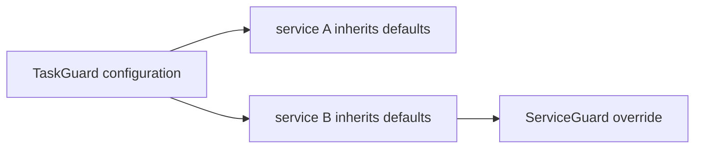
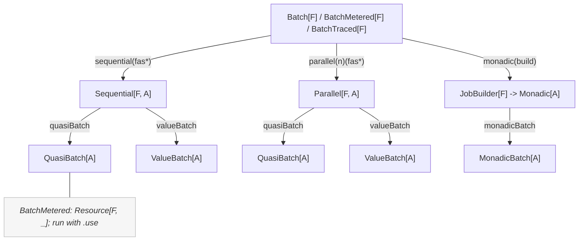
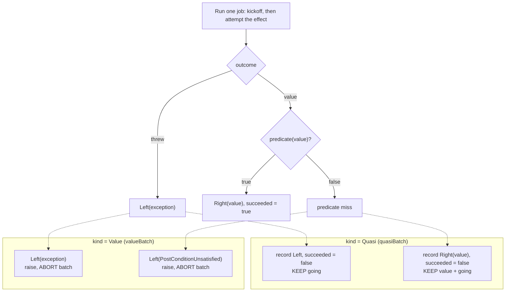
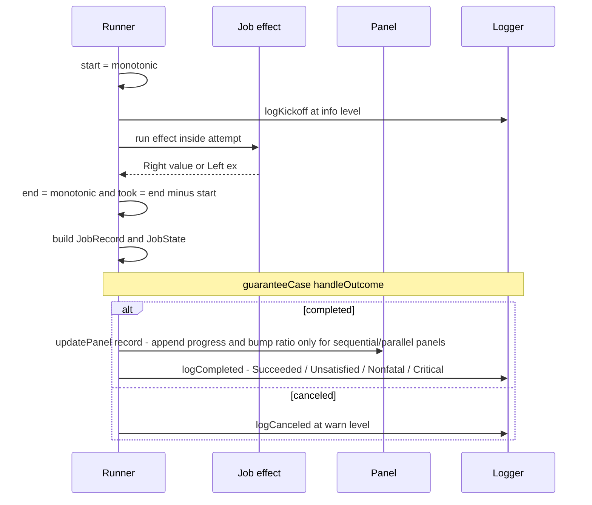
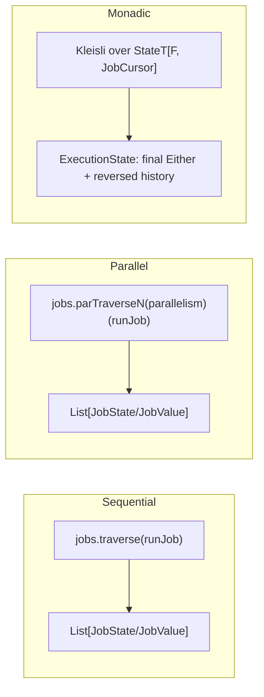
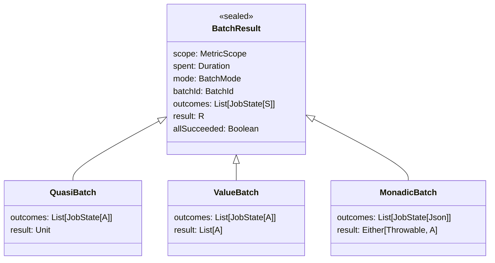
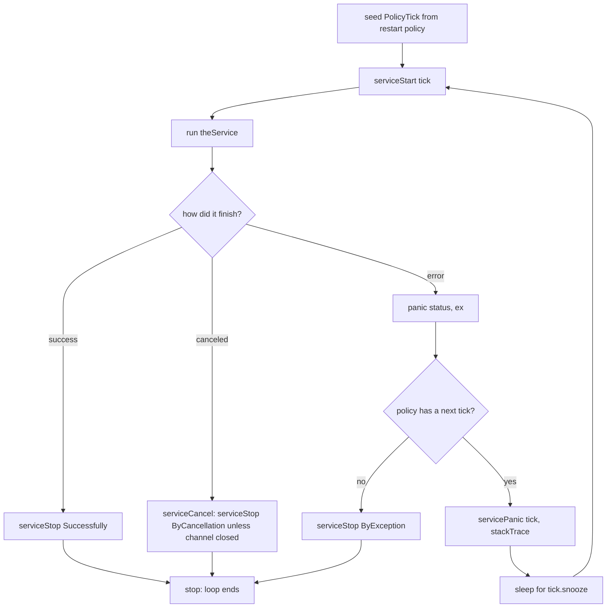
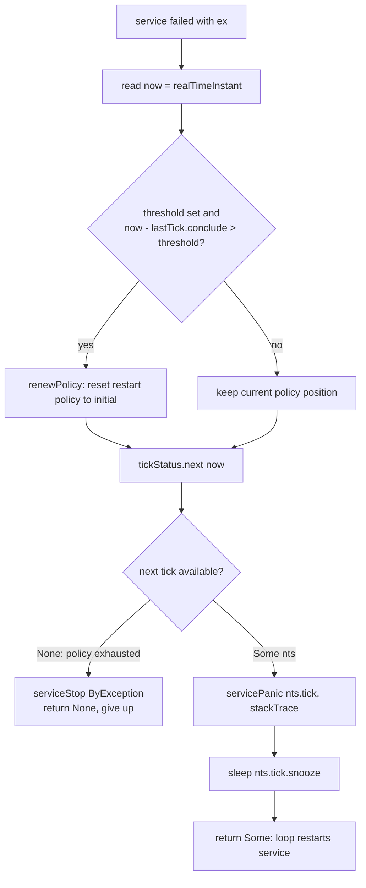

# Guard execution guide

The Guard module runs application effects as supervised services. This guide covers six parts of
that runtime:

- **Configuration** defines inherited task defaults and service-specific runtime settings.
- **Logging** emits structured application messages to a local sink and the service event stream.
- **HTTP service** exposes service controls, health, metrics, and an optional live dashboard.
- **Batch execution** groups named effects, records their timing and outcomes, and optionally adds
  progress metrics, lifecycle logs, or OpenTelemetry spans.
- **Metrics** registers scoped instruments, publishes snapshots, and optionally mirrors numeric
  measurements to OpenTelemetry.
- **Watchdog supervision** runs the service effect, applies its restart policy after failures, and
  emits service lifecycle events.

## Contents

- [Configuration](#configuration)
  - [Task defaults and service overrides](#task-defaults-and-service-overrides)
  - [Complete configuration example](#complete-configuration-example)
  - [Configuration reference](#configuration-reference)
  - [Defaults and boundaries](#defaults-and-boundaries)
  - [Resource-backed providers](#resource-backed-providers)
- [Logging](#logging)
  - [Writing messages](#writing-messages)
  - [Thresholds and delivery](#thresholds-and-delivery)
  - [Local formats](#local-formats)
- [HTTP service](#http-service)
  - [Enabling the server](#enabling-the-server)
  - [Routes](#routes)
  - [Health checks](#health-checks)
  - [Live dashboard](#live-dashboard)
- [Batch execution](#batch-execution)
  - [Choosing a façade](#choosing-a-façade)
  - [Usage examples](#usage-examples)
  - [Execution shapes](#execution-shapes)
  - [Independent-job failure models](#independent-job-failure-models)
  - [Metered job lifecycle](#metered-job-lifecycle)
  - [Execution details](#execution-details)
  - [Result types](#result-types)
  - [Report JSON and produced-value privacy](#report-json-and-produced-value-privacy)
- [Metrics](#metrics)
  - [Choosing a metrics façade](#choosing-a-metrics-façade)
  - [Resource-based example](#resource-based-example)
  - [Stream-based example](#stream-based-example)
  - [Instrument reference](#instrument-reference)
  - [Lifecycle and identity](#lifecycle-and-identity)
  - [Snapshots and reporting](#snapshots-and-reporting)
  - [OpenTelemetry export and attributes](#opentelemetry-export-and-attributes)
- [Watchdog](#watchdog)
  - [Configuring restart supervision](#configuring-restart-supervision)
  - [Supervision loop](#supervision-loop)
  - [Panic: restart or give up](#panic-restart-or-give-up)
  - [Events emitted](#events-emitted)

## Configuration

`TaskGuard` and `ServiceGuard` both expose `updateConfig`, which applies an immutable transformation
to `ServiceConfig`. Configure shared task defaults before creating services, then override only the
settings that differ for an individual service.

### Task defaults and service overrides



`TaskGuard.updateConfig` returns a new task guard. Services created from that value inherit its
configuration. `ServiceGuard.updateConfig` returns a new service guard with settings applied only to
that service. Existing task or service values are unchanged, and a later call for the same setting
replaces the earlier value. `addBrief` is the exception: repeated calls accumulate lifecycle
metadata.

### Complete configuration example

This example establishes task-wide logging, reporting, identity, and history settings, then adds a
restart policy and HTTP dashboard only to the invoice worker:

```scala
import cats.effect.IO
import com.comcast.ip4s.{ip, port}
import com.github.chenharryhua.nanjin.guard.TaskGuard
import io.circe.Json

import java.time.ZoneId
import scala.concurrent.duration.*

val billing =
  TaskGuard[IO]("billing")
    .updateConfig(
      _.withZoneId(ZoneId.of("UTC"))
        .withReportPolicy(_.fixedDelay(30.seconds).repeat)
        .withLog(_.Info, _.ConsoleJson)
        .withReportedEventThreshold(_.Warn)
        .withHomepage("https://status.example.com/billing")
        .withHistoryCapacity(panics = 20, errors = 100, metrics = 60)
        .addBrief(Json.obj("environment" -> Json.fromString("production")))
    )

val invoiceWorker =
  billing
    .service("invoice-worker")
    .updateConfig(
      _.withRestartPolicy(5.minutes, _.fixedDelay(10.seconds).repeat.limited(5))
        .withHttpServer(_.withHost(ip"127.0.0.1").withPort(port"8080"))
        .withDashboard(120, _.fixedDelay(5.seconds).repeat)
    )

val runInvoiceWorker: IO[Unit] =
  invoiceWorker
    .eventStream(_ => IO.never)
    .compile
    .drain
```

`withLog(_.Info, _.ConsoleJson)` enables compact JSON output and writes `ReportedEvent`s at `Info`
or above to that local sink. `withReportedEventThreshold(_.Warn)` independently publishes
`ReportedEvent`s at `Warn` or above to the service event stream. Service lifecycle and metrics
snapshot events are not filtered by those `ReportedEvent` thresholds.

### Configuration reference

| Method | Configures | Important behavior |
| --- | --- | --- |
| `withRestartPolicy(threshold, policy)` | Watchdog restart schedule | The policy resets after the service runs continuously for strictly longer than `threshold` |
| `withReportPolicy(policy)` | Periodic metrics snapshots | A finite policy eventually stops reporting; use `repeat` for continuing reports |
| `withLog(level, format)` | Local event-log sink and local `ReportedEvent` threshold | Formats include console text, compact or multiline JSON, verbose JSON, and SLF4J JSON |
| `withReportedEventThreshold(level)` | `ReportedEvent` publication to the event channel | Independent of the local log threshold |
| `withLogLocator(effect)` | Backend links attached to events | The effect is evaluated when the service event stream starts |
| `withZoneId(zoneId)` | Scheduling and timestamp zone | Accepts a `ZoneId` or a builder over predefined `zones` |
| `withHomepage(uri)` | Homepage in service identity | Parses the string immediately and throws for an invalid URI |
| `addBrief(value)` | JSON metadata on service lifecycle events | Accepts an encoded value, by name or in `F`; metadata is absent from metrics snapshots and reported messages |
| `withHttpServer(builder)` | Embedded Ember HTTP server | Enables service and dashboard routes and customizes the default server builder |
| `withDashboard(maxPoints, policy)` | Live WebSocket metrics chart | Requires the HTTP server; the policy controls chart sampling |
| `withHistoryCapacity(panics, errors, metrics)` | In-memory dashboard histories | Each argument controls an independent ring buffer |
| `withMeterProvider(resource)` | OpenTelemetry metric provider | Enables OpenTelemetry metric recording in addition to Guard snapshots |
| `withTracerProvider(resource)` | OpenTelemetry trace provider | Supplies the tracer used by `Agent` and `BatchTraced` |

The available `LogFormat` cases are `ConsolePlainText`, `ConsoleJson`, `ConsoleJsonMultiLine`,
`ConsoleJsonVerbose`, and `Slf4jJson`.

### Defaults and boundaries

| Setting | Default |
| --- | --- |
| Time zone | `ZoneId.systemDefault()` |
| Restart policy | Empty; the first service failure stops with `ByException` |
| Metrics report policy | Empty; no periodic snapshots |
| Local log format | None; the local event-log sink is disabled |
| Local and event-channel `ReportedEvent` thresholds | `Error` |
| Log locator, homepage, and lifecycle brief | Absent |
| HTTP server and dashboard | Disabled |
| Panic, error, and metrics history | Disabled |
| OpenTelemetry meter and tracer providers | No-op providers |

Each `withHistoryCapacity` value of zero or less disables that individual history. At service start,
`addBrief` values are encoded, JSON nulls are removed, and duplicate JSON values are collapsed. See
[HTTP service](#http-service) for server defaults, exposure, and health-check behavior.

### Resource-backed providers

`withMeterProvider` and `withTracerProvider` accept `Resource` values. Guard acquires both providers
when the service event stream starts, keeps them alive across watchdog restart attempts, and releases
them when the event stream terminates. Their acquisition failures fail service startup.

The configured meter provider backs `MetricsHub`'s OpenTelemetry-capable instruments. The configured
tracer provider supplies `agent.tracer`, `agent.tracerProvider`, and the parent and child spans opened
by `agent.batchTraced`. The default no-op providers let metrics and tracing calls run without a
configured exporter.

See [`TaskGuard.scala`](../src/main/scala/com/github/chenharryhua/nanjin/guard/TaskGuard.scala) and
[`ServiceGuard.scala`](../src/main/scala/com/github/chenharryhua/nanjin/guard/service/ServiceGuard.scala)
for configuration inheritance and service startup,
[`ServiceConfigF.scala`](../src/main/scala/com/github/chenharryhua/nanjin/guard/config/ServiceConfigF.scala)
for the public configuration API, and
[`ServiceParams.scala`](../src/main/scala/com/github/chenharryhua/nanjin/guard/config/ServiceParams.scala)
for evaluated runtime settings and defaults.

## Logging

The `Agent` passed to a service exposes `logger: Log[F]`. Logging creates `ReportedEvent`s that
can be written to a local sink and published on the service event stream. These are separate paths
with independent thresholds.

### Writing messages

```scala
import cats.effect.IO
import cats.syntax.all.*
import com.github.chenharryhua.nanjin.guard.TaskGuard
import io.circe.Json

val loggingService =
  TaskGuard[IO]("billing")
    .service("invoice-worker")
    .updateConfig(
      _.withLog(_.Info, _.ConsoleJson)
        .withReportedEventThreshold(_.Warn)
    )

val runWithLogging: IO[Unit] =
  loggingService
    .eventStream { agent =>
      val log = agent.withDomain("invoices").logger
      log.info(Json.obj("action" -> Json.fromString("started"))) >>
        log.warn("invoice needs review", new RuntimeException("validation failed"))
    }
    .compile
    .drain
```

`debug`, `info`, `good`, `warn`, and `error` accept any message with a Circe `Encoder`; `warn` and
`error` also accept a throwable. Use `emit` with a `LogEntry` or explicit level for a dynamically
chosen severity. Messages are by-name and are not evaluated or encoded when neither threshold
accepts their level.

Each `ReportedEvent` carries the encoded message, level, optional stack trace, timestamp, service
identity, domain, and correlation identifier. The default domain is `main`; `withDomain` returns a
view with a different domain while sharing the service resources and thresholds. An optional
`withLogLocator` supplies links to a log backend for service, reported, and metrics events.

### Thresholds and delivery

Levels increase in the order `Debug`, `Info`, `Good`, `Warn`, `Error`. `withLog(level, format)`
enables the local sink and sets its `ReportedEvent` threshold; `withReportedEventThreshold(level)`
sets the event-channel threshold. Both thresholds default to `Error`, and the local sink is disabled
until a format is configured. In the example, the info message goes only to the local sink; the
warning goes to both paths. Compiling the event stream with `drain` discards its events: attach an
observer or otherwise consume them when they must be delivered elsewhere.

These thresholds do not filter service lifecycle events or metrics snapshots. An enabled local sink
also renders those events. The HTTP server can change the two `ReportedEvent` thresholds for the
running service; see [Routes](#routes). A downstream `EventPipe.logLevel` can further filter
reported events without filtering other event types.

Logging is best-effort: `Log.emit` suppresses errors from checking the level, encoding, and
publishing, so a successful logging effect does not guarantee delivery. The local sink is written
before the event channel; a local write failure can prevent that message from reaching the channel.
Do not use the logger as a durable audit record. Error-level reported events are also kept in the
configured bounded error history when publication reaches that step.

### Local formats

| Format | Output |
| --- | --- |
| `ConsolePlainText` | ANSI-formatted text |
| `ConsoleJson` | Compact presentation JSON |
| `ConsoleJsonMultiLine` | Indented presentation JSON |
| `ConsoleJsonVerbose` | Indented JSON encoding of the full event |
| `Slf4jJson` | Compact presentation JSON through the SLF4J logger named after the service |

Console output prefixes each rendered event with its timestamp and service name, so it is not a
standalone JSON document or JSON Lines stream. `Slf4jJson` maps `Good` to SLF4J `INFO`; the SLF4J
backend's own configuration can further filter output. Avoid logging sensitive payloads or
exception details unless the destinations are appropriate for them.

See [`Log.scala`](../../common/src/main/scala/com/github/chenharryhua/nanjin/common/logging/Log.scala),
[`ReportedEventHandler.scala`](../src/main/scala/com/github/chenharryhua/nanjin/guard/service/ReportedEventHandler.scala),
and [`EventLogSink.scala`](../src/main/scala/com/github/chenharryhua/nanjin/guard/service/EventLogSink.scala)
for the logging API and delivery paths.

## HTTP service

Guard can run an embedded Ember server alongside the service event stream. It provides operational
routes and, optionally, a live metrics dashboard. The server is disabled by default and is released
when the event stream terminates; watchdog restarts do not create a new server.

### Enabling the server

Use `withHttpServer` to enable the data routes and customize the Ember builder. Guard supplies a
default host of `0.0.0.0` and port `1026` before applying the builder transformation. The
[configuration example](#complete-configuration-example) binds to `127.0.0.1:8080`, enables
snapshot and panic histories, and configures the dashboard. While that service is running:

```shell
curl http://127.0.0.1:8080/health
curl http://127.0.0.1:8080/params
curl http://127.0.0.1:8080/metrics/report
```

**The server provides no authentication or authorization.** Anyone who can reach it can stop the
service, change log thresholds, and read service parameters and JVM details, including input
arguments. Bind to loopback for local use, or restrict direct access and use an authenticating
proxy. The all-interfaces default can be useful for containers but must not be exposed unprotected.

### Routes

These routes are available whenever the HTTP server is enabled, even without the dashboard:

| Method and path | Behavior |
| --- | --- |
| `GET /health` | Health verdict; see [Health checks](#health-checks) |
| `GET /panics` | Service status and retained restart panic history |
| `GET /errors` | Retained error-level `ReportedEvent` history |
| `GET /params` | Service parameters and current log thresholds |
| `GET /metrics/jvm` | JVM information, including input arguments and deadlocked thread details |
| `GET /metrics/report` | Full on-demand metrics snapshot rendered as HTML; does not publish an event or add to history |
| `GET /metrics/history` | Retained metrics snapshots rendered as HTML |
| `GET /log/level` | Current local logger and event-channel thresholds |
| `POST /log/logger/{level}` | Change the local `ReportedEvent` threshold |
| `POST /log/channel/{level}` | Change the event-channel `ReportedEvent` threshold |
| `POST /stop` | Stop the service with `StopReason.Maintenance` |

Log levels are `Debug`, `Info`, `Good`, `Warn`, and `Error`, matched case-insensitively. A
successful threshold change returns the previous and current settings; an invalid level returns
HTTP 400. Threshold changes apply to the running service, not its immutable configuration.

Panic, error, and metrics histories are independent bounded in-memory buffers configured with
`withHistoryCapacity`; they are disabled by default and lost when the service event stream ends.
Periodic reports or `agent.adhoc.report` populate metrics history when enabled.

### Health checks

`GET /health` also has aliases `/health_check`, `/healthCheck`, `/healthcheck`, `/healthz`, and
`/healthcheck/status`. It returns HTTP 503 while a retained panic has a restart scheduled in the
future. Otherwise it returns HTTP 200 with a JSON `healthy` field, including when that field is
`false`; clients must inspect the body as well as the status.

The dependency verdict uses health-check gauges from the latest retained metrics snapshot, not a
live scrape. With no retained snapshot or no boolean health-check values, it reports `healthy: true`
even if checks would fail. Metrics and panic histories are disabled by default, and the default
report policy produces no periodic snapshots. Configure both histories and periodic or ad-hoc
reports as appropriate, and account for snapshot staleness. Disabled panic history also prevents the
endpoint from detecting a pending restart.

### Live dashboard

`withDashboard(maxPoints, policy)` adds `GET /dashboard`, its static assets, and the WebSocket feed
at `/dashboard/ws`, but only when the HTTP server is also enabled and `maxPoints > 1`. Otherwise
the data routes remain available without dashboard routes. The policy controls the sampling
schedule; use a repeating policy for ongoing updates.

The feed charts meter and timer counts. Its first sample contains counts accumulated since instrument
acquisition; later samples are deltas. Slow WebSocket clients can lose older points, and the history
to live transition can repeat a point. Series labels combine the scope label and metric name, so
same-named live instruments in the same scope can share a label. The dashboard page loads Chart.js,
Luxon, and the Chart.js Luxon adapter from a CDN.

See [`HttpServer.scala`](../src/main/scala/com/github/chenharryhua/nanjin/guard/service/dashboard/HttpServer.scala),
[`HttpDataRouter.scala`](../src/main/scala/com/github/chenharryhua/nanjin/guard/service/dashboard/HttpDataRouter.scala),
and [`HttpWsRouter.scala`](../src/main/scala/com/github/chenharryhua/nanjin/guard/service/dashboard/HttpWsRouter.scala)
for server and route behavior.

## Batch execution

The `batch` package runs named jobs under a shared metric scope and returns one aggregate
`BatchResult`. Obtain a batch façade from the `Agent` passed to `ServiceGuard.eventStream`,
`eventStreamS`, or `eventStreamR`.

### Choosing a façade

All three façades support sequential, bounded-parallel, and monadic execution. They differ in their
observability and result scope.

| Façade | Construct with | Observability | Batch result |
| --- | --- | --- | --- |
| `Batch[F]` | `agent.batch(label)` | None; lightweight execution only | `F[...]` |
| `BatchMetered[F]` | `agent.batchMetered(label)` | Per-job lifecycle logs and a live progress panel | `Resource[F, ...]` |
| `BatchTraced[F]` | `agent.batchTraced(label, buildParent)` | One parent OpenTelemetry span and one child span per job | `F[...]` |

`BatchTraced` does not add the lifecycle logs or progress metrics supplied by `BatchMetered`.
Its sequential and parallel jobs receive their child `Span[F]`; its monadic builder accepts either a
plain effect or a span-aware function.

### Usage examples

The examples use a `ServiceGuard[IO]` and compile its event stream to run the supervised effect:

```scala
import cats.effect.IO
import com.github.chenharryhua.nanjin.guard.TaskGuard
import org.typelevel.otel4s.trace.Span

val service = TaskGuard[IO]("example").service("worker")
```

Use `Batch` when only the result matters. A post-condition marks non-positive values as unmet, while
`quasiBatch` still returns every outcome:

```scala
val runLightweight: IO[Unit] =
  service
    .eventStream { agent =>
      agent
        .batch("health-checks")
        .sequential(
          "database" -> IO.pure(1),
          "broker" -> IO.pure(1)
        )
        .withPostCondition(_ > 0)
        .quasiBatch
        .flatMap(result => IO.println(s"all checks passed: ${result.allSucceeded}"))
    }
    .compile
    .drain
```

Use `BatchMetered` for lifecycle logs and live progress metrics. Its result is a `Resource`, so run it
with `use`:

```scala
val runMetered: IO[Unit] =
  service
    .eventStream { agent =>
      agent
        .batchMetered("prepare-report")
        .monadic { job =>
          for {
            count <- job("count-records", IO.pure(3))
            report <- job("build-report", IO.pure(s"records: $count"))
          } yield report
        }
        .monadicBatch
        .use(result => IO.println(result.result))
    }
    .compile
    .drain
```

Use `BatchTraced` when each job needs an OpenTelemetry child span. `_.build` opens the preconfigured
parent span without further customization:

```scala
val runTraced: IO[Unit] =
  service
    .eventStream { agent =>
      agent
        .batchTraced("fetch-shards", _.build)
        .parallel(2)(
          "shard-a" -> ((_: Span[IO]) => IO.pure(10)),
          "shard-b" -> ((_: Span[IO]) => IO.pure(20))
        )
        .valueBatch
        .flatMap(result => IO.println(result.result.sum))
    }
    .compile
    .drain
```

### Execution shapes

Choose the façade first, then choose an execution shape and its failure handling. For
`BatchMetered`, each terminal operation shown below returns `Resource[F, ...]` rather than `F[...]`.



- **Sequential** runs independent jobs in declaration order.
- **Parallel** runs independent jobs with bounded concurrency. `parallel(fas*)` uses the number of
  jobs as the bound, or one for an empty batch; `parallel(n)(fas*)` requires `n > 0`.
- **Monadic** composes dependent jobs with `map` and `flatMap`. `monadicBatch` returns the recorded
  history and the final `Either`.

`BatchMetered` runs a batch when its result resource is used, then releases its active gauge and
metric writers when the resource closes. `Batch` and `BatchTraced` return their results directly in
`F`.

### Independent-job failure models

For sequential and parallel batches, the terminal operation sets each job's `BatchKind` and
determines how exceptions and post-condition misses affect the batch. Monadic jobs have no
`BatchKind`; they short-circuit into `MonadicBatch.result` instead.



So:

- **Quasi** runs every job and records each exception or rejected value. `allSucceeded` is `false`
  when any job throws or misses its post-condition.
- **Value** raises the first observed exception or rejected value. Sequential execution does not
  start later jobs; parallel execution cancels outstanding siblings. A `ValueBatch` therefore exists
  only after all jobs have succeeded, and its `allSucceeded` value is always `true`.

### Metered job lifecycle

Sequential and parallel `BatchMetered` jobs follow the lifecycle below. Timing brackets the kickoff
log and job effect; the completion log is written after `end` and is not part of `took`.



For sequential and parallel jobs, `handleOutcome` runs in a `guaranteeCase` finalizer. On
`Outcome.Succeeded` it updates progress and emits a completion log; on `Outcome.Canceled` it emits
only `logCanceled`. On `Outcome.Errored` it emits an internal "should not happen" error log.

Monadic metered jobs emit kickoff before running the effect, then defer completion until
`predicate`, `attempt`, and rendering combinators have finalized the recorded state. Genuine
cancellation emits `logCanceled`. `Batch` and `BatchTraced` do not use this logging or panel
lifecycle.

### Execution details



- **Sequential** uses `traverse`; **Parallel** uses `parTraverseN`. Both time the whole traversal as
  `spent` and build the result from the collected `JobState` or `JobValue` list.
- **Monadic** threads a `JobCursor` containing the next index and a carry-over start time through
  `StateT` and `Kleisli`. A tracked job starts from the previous cursor time, so untracked work
  between jobs is included in the next tracked job's `took`. The aggregate `spent` brackets the
  whole chain and can also include setup or finalization outside those per-job durations. A `Left`
  short-circuits the remaining chain; `withFilter` turns a rejected value into a
  `PostConditionUnsatisfied` `Left`.

### Result types



`allSucceeded` checks only the recorded jobs:

- A `QuasiBatch` records every job, so `allSucceeded` is `false` when any recorded outcome failed or
  missed its post-condition.
- A `ValueBatch` is returned only after every job succeeds, so its value is always `true`.
- A `MonadicBatch` records only named jobs that ran before the chain finished or short-circuited.
  Inspect `result` to determine whether the chain produced its final value. An untracked failure can
  make `result` a `Left` without adding a failed job, leaving `allSucceeded` as `true`.

See [`data.scala`](../src/main/scala/com/github/chenharryhua/nanjin/guard/batch/data.scala) for the
public result and job types, [`ExecutionState.scala`](../src/main/scala/com/github/chenharryhua/nanjin/guard/batch/ExecutionState.scala)
for monadic execution state, and [`JobLog.scala`](../src/main/scala/com/github/chenharryhua/nanjin/guard/batch/JobLog.scala)
for outcome classification and report rendering.

### Report JSON and produced-value privacy

Each completed job is classified by `toLogEntry` into a `JobLog` case (`Succeeded`, `Unsatisfied`,
`Nonfatal`, or `Critical`) carrying the log level. `BatchMetered` automatically emits the
`standalone` rendering after each job; explicit batch-result serialization uses `inBatch`. The two
renderings enforce the produced-value privacy boundary:

- `standalone` shows only lifecycle facts: the job identity, `took`, and the outcome tag. It omits
  both the produced value and exception message; failures are carried as the log entry's cause.
- `inBatch` — the rendering nested under a `BatchResult` when the user **explicitly** serializes
  the returned result. Successful values and abbreviated exception messages are stored under the
  corresponding outcome tag (`succeeded`, `unsatisfied`, `nonfatal`, or `critical`), with `took` as a
  separate field.

Why the split matters: a job's produced value is the user's data. The automatic log must not leak
it without the user's agreement, so the produced value is shown only where the user opts in by
serializing the result. This is enforced by types, not convention:

- `inBatch` takes `(using Encoder[A])`; `standalone` takes no encoder. So the auto-emitted path
  **cannot** render the value — there is no encoder in scope to do it.
- Consequently `Encoder[A]` is required only at the `QuasiBatch`/`ValueBatch`/`MonadicBatch`
  encoders (which call `inBatch`), never on the batch builders. You can run any batch over any `A`;
  you only need an `Encoder[A]` if you serialize the result.
- The lifecycle-only cases `Kickoff`/`Canceled` extend `JobLog[Nothing]`, so `inBatch` (which needs
  `Encoder[A]`) is uncallable for them and `toLogEntry` cannot classify a job into them. The
  "kickoff/cancel never reach a batch-nested render" invariant is a compile-time guarantee.

Keys in serialized batch results:

| Key | Meaning |
| --- | --- |
| `Sequential Quasi Batch`, `Parallel-<n> Value Batch`, or `Monadic Batch` | dynamic batch-mode key whose value is the batch label |
| `id` | batch identifier |
| `spent` | total batch duration |
| `failed` | number of unsuccessful jobs; present only on `QuasiBatch` |
| `jobs` | array of per-job outcome objects |
| `job-<index>` | configured name of a job, keyed by its 1-based index inside a `jobs` entry |
| `succeeded`, `unsatisfied`, `nonfatal`, or `critical` | produced value or abbreviated exception message in a serialized result; lifecycle-only metadata in an automatically emitted standalone log |
| `took` | per-job duration |
| `traceparent` | W3C trace context; present only for traced jobs |
| `result` | final value of a successful `MonadicBatch`; omitted when the chain fails |

The exact dynamic batch key includes its mode and, for independent jobs, its kind. A monadic batch
serializes its final value under `result` only on success. Inspect the returned `result` for the
failure throwable: an untracked failure has no job log, and serialized failed job entries can include
abbreviated exception messages. Monadic per-job outcomes are `JobState[Json]`: `renderOutcome` or
`render` can supply a JSON payload, while unrendered jobs retain `Json.Null` under their outcome tag.

## Metrics

The `metrics` package registers instruments under a service-owned `MetricScope`. Each scope combines
the label supplied by the application with the current agent domain, service, and task. Instruments
feed Guard's metric snapshots and can also write numeric measurements to OpenTelemetry.

### Choosing a metrics façade

The two façades expose the same instruments with different composition types:

| Façade | Obtain with | Registration type | Use when |
| --- | --- | --- | --- |
| `MetricsHub[F]` | `agent.metricsHub(label)` | `Resource[F, A]` | Metrics are used inside an effect or combined with other resources |
| `MetricsHubS[F]` | `agent.metricsHubS(label)` | `Stream[F, A]` | Metric registration belongs inside an fs2 stream |

`agent.facilitate(label)(f)` applies `f` to a `MetricsHub`, while `facilitateS` does the same for a
`MetricsHubS`. These helpers only remove the intermediate variable; they do not change registration,
reporting, or resource lifetime.

### Resource-based example

Acquire all instruments before updating them, and keep the resource open for as long as snapshots
should include them. This example updates three push instruments, exposes one pull-based gauge, and
publishes a full snapshot before release:

```scala
import cats.effect.IO
import cats.syntax.all.*
import com.github.chenharryhua.nanjin.guard.TaskGuard
import squants.information.Bytes

val metricsService = TaskGuard[IO]("example").service("metrics-worker")

val runResourceMetrics: IO[Unit] =
  metricsService
    .eventStream { agent =>
      agent.facilitate("orders") { hub =>
        (
          hub.counter(
            "requests",
            _.withDescription("Accepted requests")
              .withAttributes("endpoint" -> "/orders")
          ),
          hub.histogram("payload-size", _.withUnit(Bytes)),
          hub.timer("latency"),
          hub.numericGauge("queue-depth", IO.pure(7L))
        ).tupled.use { case (requests, payloadSize, latency, _) =>
          requests.inc(1) >>
            payloadSize.update(2048) >>
            latency.timing(IO.unit) >>
            agent.adhoc.report
        }
      }
    }
    .compile
    .drain
```

`agent.adhoc.report` publishes an immediate `MetricsSnapshot`. After `use` completes, Guard
removes the four Dropwizard registry entries and closes the `numericGauge` OpenTelemetry callback.
The push-based OpenTelemetry instruments remain owned by the configured `MeterProvider`.

### Stream-based example

`MetricsHubS` wraps each metric resource in a stream. Registration begins when the stream runs and
ends when that stream scope terminates:

```scala
import cats.effect.IO
import fs2.Stream

val records = Stream.emits(List("a", "b", "c")).covary[IO]

val runStreamMetrics: IO[Unit] =
  metricsService
    .eventStreamS { agent =>
      agent.facilitateS("ingest") { hub =>
        hub
          .counter("processed", _.withAttributes("source" -> "file"))
          .flatMap { counter =>
            records.evalTap(_ => counter.inc(1)).drain ++
              Stream.eval(agent.adhoc.report)
          }
      }
    }
    .compile
    .drain
```

### Instrument reference

| Instrument | Represents | Update or registration | Backend |
| --- | --- | --- | --- |
| `counter` | Adjustable count, optionally reset by a policy | `inc(n)` | Dropwizard and OpenTelemetry `UpDownCounter` |
| `meter` | Event count and moving rates | `mark(n)` | Dropwizard and OpenTelemetry monotonic `Counter` |
| `histogram` | Distribution of observed integer values | `update(n)` | Dropwizard and OpenTelemetry `Histogram` |
| `timer` | Call rate and duration distribution | `elapsed(duration)`, `elapsedNano(n)`, or `timing(effect)` | Dropwizard and OpenTelemetry duration `Histogram` |
| `gauge` | Arbitrary effectful value with an `Encoder` | `register(effect)` | Dropwizard only |
| `numericGauge` | Pull-based `Long` value | supply the effect when registering | Dropwizard and OpenTelemetry `ObservableGauge` |
| `healthCheck` | Boolean health state; failures and timeouts become `false` | `register(effect)` | Dropwizard only |
| `ratio` | Accumulated numerator and denominator rendered as JSON | `incNumerator`, `incDenominator`, or `incBoth` | Dropwizard only |
| `idleGauge` | Time since the last activity | `wakeUp` resets the timer | Dropwizard only |
| `activeGauge` | Time since acquisition while activity remains active | `deactivate` stops reporting a value | Dropwizard only |
| `frequencyCounter` | Counts grouped by string tag | `inc(tag)` or `inc(tag, n)` | Dropwizard only |

OpenTelemetry-capable builders support `enable`, descriptions, and type-specific settings. Meters and
histograms accept Squants units; histograms and timers can customize their Dropwizard reservoirs and
OpenTelemetry bucket boundaries. Timers record OpenTelemetry durations in seconds unless
`withTimeUnit` selects another unit. `gauge` and `healthCheck` support timeouts and optional refresh
policies. Disabled instruments register nothing, so updates have no reported effect.

### Lifecycle and identity

Every enabled acquisition mints a new `MetricToken` and therefore a distinct `MetricId`, even when
two live instruments use the same name. Guard stores the encoded `MetricId` as the Dropwizard
registry key, which keeps same-named acquisitions and category variants separate. Releasing the
resource removes that exact registry entry.

This differs from process-lifetime metric registries:

- A metric appears in Guard snapshots only while its `Resource` or `Stream` scope is active.
- Reacquiring the same name creates a new metric instance rather than recovering an old value.
- Two same-named OpenTelemetry instruments can still aggregate into one series when their names and
  attributes match, because OpenTelemetry does not use Guard's per-acquisition token.

A counter's Dropwizard value can be reset by its configured policy, making it cumulative within the
current reporting window. Its OpenTelemetry `UpDownCounter` is not reset; the OpenTelemetry backend
owns cumulative or delta temporality.

### Snapshots and reporting

Guard turns the currently registered Dropwizard metrics into `MetricsSnapshot` events:

| API | Behavior |
| --- | --- |
| `ServiceConfig.withReportPolicy` | Schedules full snapshots that are published to the service event channel, written to the log sink, and retained in configured history |
| `agent.adhoc.report` | Immediately publishes one full snapshot through the same paths |
| `agent.adhoc.snapshots(policy)` | Returns snapshots on a caller-owned stream; defaults to `ScrapeMode.Cheap` and does not publish them to the service event channel |
| `agent.adhoc.meteredCounts(policy)` | Streams counts for meters and timers, then deltas between samples |

`ScrapeMode.Cheap` reads counters, meters, histograms, and timers but skips gauges. `ScrapeMode.Full`
also evaluates gauges and is used for configured periodic reports and `agent.adhoc.report`. Snapshot
scraping omits zero-valued counters and gauges whose encoded value is `Json.Null`.

The first `meteredCounts` emission contains the counts accumulated since each instrument was
acquired, not a one-interval delta. Later emissions contain differences from the previous sample;
an instrument first seen in a later sample likewise contributes its accumulated count.

The default report policy is empty, so no periodic snapshots are published until
`withReportPolicy` is configured. On-demand reporting remains available through `agent.adhoc`.

### OpenTelemetry export and attributes

Every enabled instrument records in Guard's Dropwizard snapshot registry. When
`ServiceConfig.withMeterProvider` supplies a real otel4s `MeterProvider`, `counter`, `meter`,
`histogram`, `timer`, and `numericGauge` also record through OpenTelemetry. The default provider is a
no-op.

Every OpenTelemetry point includes these framework attributes:

| Attribute | Source |
| --- | --- |
| `nj.label` | label passed to `metricsHub`, `metricsHubS`, `facilitate`, or `facilitateS` |
| `nj.domain` | current `Agent` domain |
| `nj.service` | service name |
| `nj.task` | task name |

The OpenTelemetry-capable builders accept additional string attributes through
`withAttributes((key, value)*)`. These attributes are fixed for the life of the instrument and do
not affect Dropwizard snapshots. Keep them low-cardinality. Caller attributes win conflicts with
framework attributes, and the first value wins when a key is repeated.

Arbitrary JSON gauges and derived gauges are Dropwizard-only because OpenTelemetry gauges require a
numeric measurement type. Use `numericGauge` when a `Long` value must reach both backends.

See [`MetricsHub.scala`](../src/main/scala/com/github/chenharryhua/nanjin/guard/metrics/MetricsHub.scala)
and [`MetricsHubS.scala`](../src/main/scala/com/github/chenharryhua/nanjin/guard/metrics/MetricsHubS.scala)
for registration APIs, [`MetricId.scala`](../src/main/scala/com/github/chenharryhua/nanjin/guard/metrics/MetricId.scala)
for scope and identity, [`AdhocReport.scala`](../src/main/scala/com/github/chenharryhua/nanjin/guard/service/AdhocReport.scala)
for on-demand reporting, and [`ScrapeMetrics.scala`](../src/main/scala/com/github/chenharryhua/nanjin/guard/metrics/snapshot/ScrapeMetrics.scala)
for snapshot interpretation.

## Watchdog

The watchdog is the supervisor that keeps a service running. It runs the user's service effect,
and when that effect fails it decides — using the configured restart policy — whether to wait and
restart, or to give up and stop. It also emits the service lifecycle events (`ServiceStart`,
`ServicePanic`, `ServiceStop`) that observers see.

`watchdog(theService, handler)` returns a `Stream[F, Nothing]` that `ServiceGuard` runs
`concurrently` with the main event channel, periodic metric reporting, and the HTTP server.
`theService` is the deferred agent work; `handler` publishes lifecycle events.

### Configuring restart supervision

The default restart policy is empty, so the first service failure stops the service. Configure
restarts through `ServiceGuard.updateConfig` before starting the event stream:

```scala
import cats.effect.IO
import com.github.chenharryhua.nanjin.guard.TaskGuard

import scala.concurrent.duration.*

def supervised(worker: IO[Unit]): IO[Unit] =
  TaskGuard[IO]("billing")
    .service("invoice-worker")
    .updateConfig(
      _.withRestartPolicy(
        1.minute,
        _.fixedDelay(5.seconds).repeat.limited(5)
      )
    )
    .eventStream(_ => worker)
    .compile
    .drain
```

This policy waits five seconds between restart attempts. If the service runs continuously for
strictly longer than one minute before failing, the watchdog resets the policy to its initial
position before requesting the next restart tick.

When the policy is exhausted, the worker failure is reported as `ServiceStop(ByException)` and the
event stream normally completes rather than raising that failure. The example drains and discards
that event, so callers that need to detect failure must inspect the stop reason instead.

### Supervision loop

The loop is an `unfoldEval` over a `PolicyTick` (the restart policy's current position). Each
iteration starts the service, then branches on how the service effect finished.



- **success**: the service finished on its own; the watchdog reports `Successfully` and the loop
  ends. No restart.
- **canceled**: on cancellation `serviceCancel` reports `ByCancellation`, but only if the event
  channel is not already closed (the check is best-effort and relies on idempotent channel close).
- **error**: control passes to `panic`, which decides restart vs give-up.

### Panic: restart or give up

`panic` is where the restart policy is consulted. Two things happen: an optional policy reset
based on the success threshold, then a step of the policy to get the next delay.



- **Threshold reset**: `RestartPolicy` carries an optional `threshold`. If the service ran longer
  than `threshold` since the previous tick concluded, the failure is treated as isolated and the
  policy is renewed to its initial state (so a long-healthy service that trips gets the full
  restart budget again). With no threshold, the policy position is preserved across failures.
- **Policy step**: `PolicyTick.next(now)` advances the policy. `None` means the policy is
  exhausted — the watchdog reports `ByException` and stops for good. `Some(nts)` yields the next
  tick; the watchdog emits `ServicePanic`, sleeps for that tick's `snooze` delay, then loops to
  restart the service.

### Events emitted

| Situation | Event |
| --- | --- |
| each (re)start of the service | `ServiceStart` |
| a failure that will be retried | `ServicePanic` |
| clean completion | `ServiceStop(Successfully)` |
| policy exhausted after failure | `ServiceStop(ByException)` |
| cancellation | `ServiceStop(ByCancellation)` |

See [`watchdog.scala`](../src/main/scala/com/github/chenharryhua/nanjin/guard/service/watchdog.scala)
for the loop, [`ServiceParams.scala`](../src/main/scala/com/github/chenharryhua/nanjin/guard/config/ServiceParams.scala)
for `RestartPolicy`, and [`PolicyTick.scala`](../../common/src/main/scala/com/github/chenharryhua/nanjin/common/chrono/PolicyTick.scala)
for policy stepping and `snooze`.
