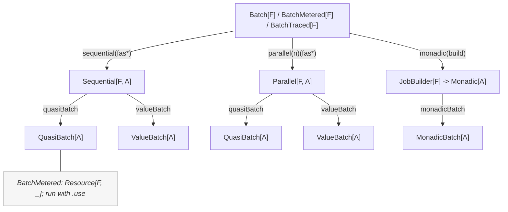
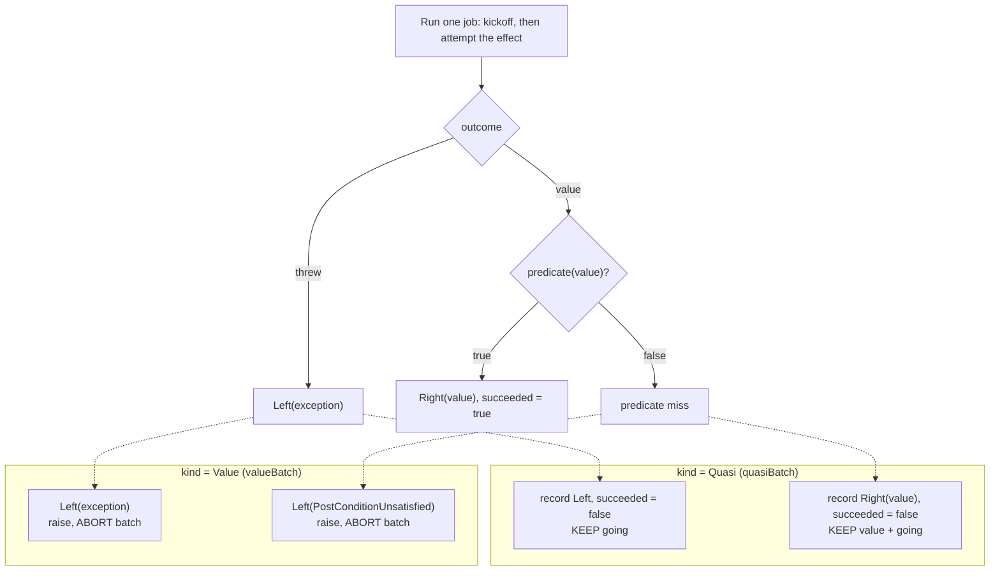
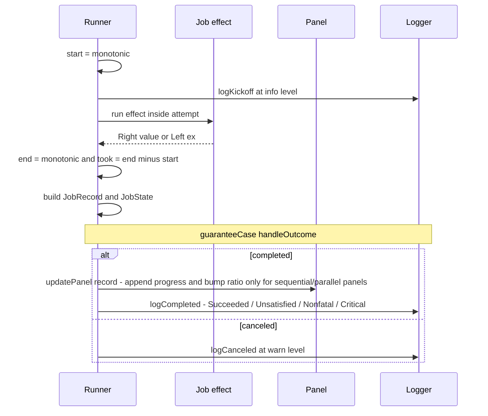
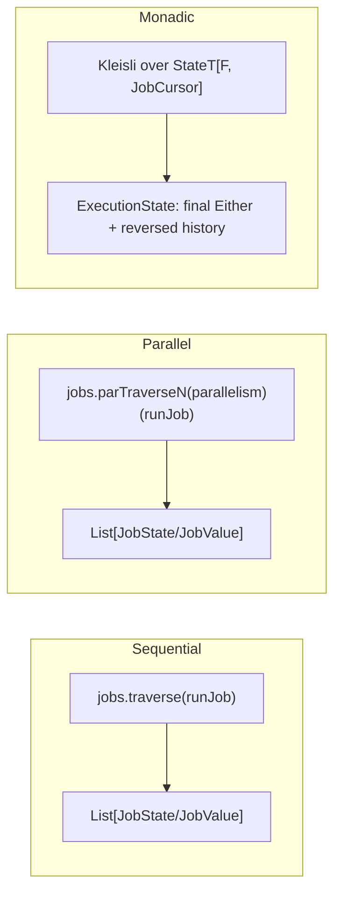
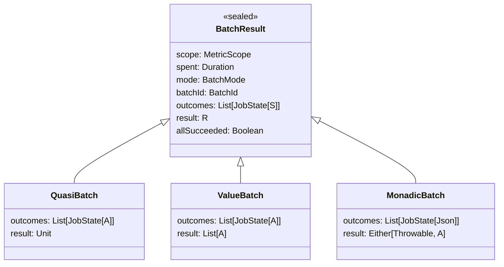
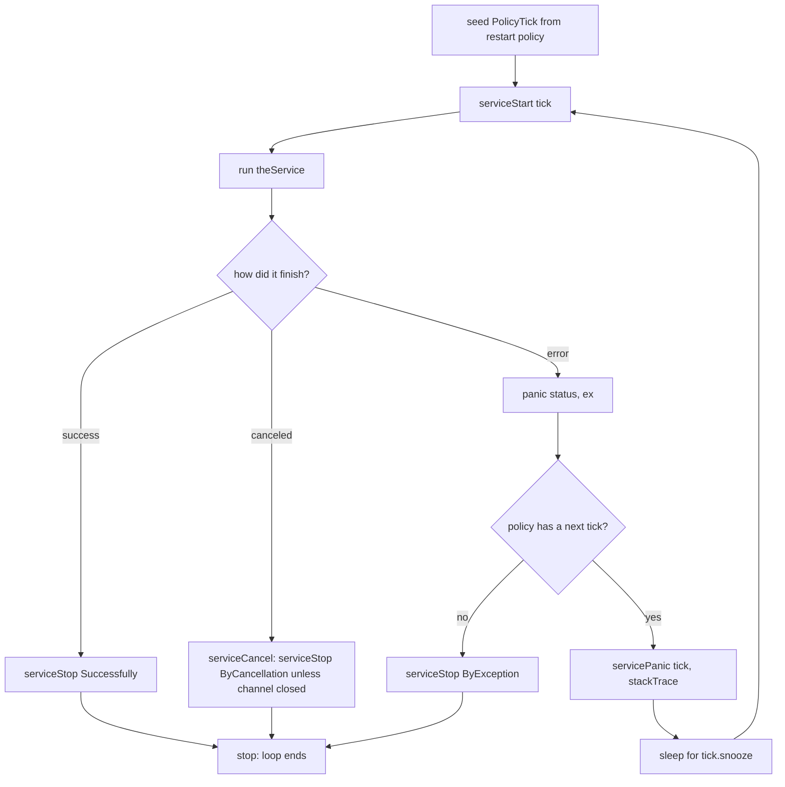
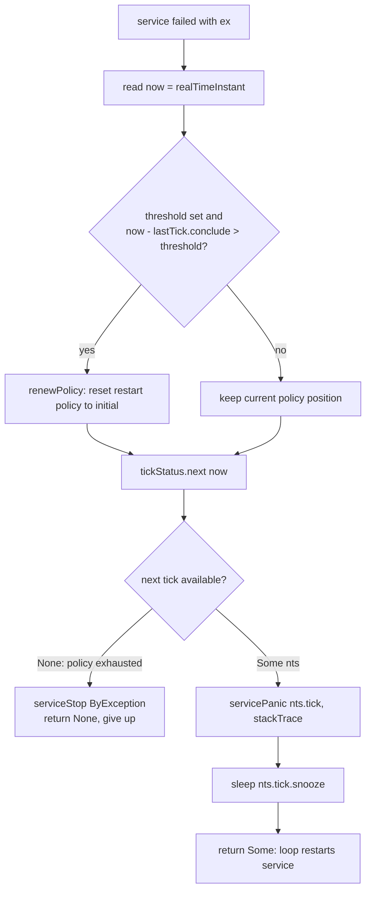

# Guard execution guide

The Guard module runs application effects as supervised services. This guide covers two parts of
that runtime:

- **Batch execution** groups named effects, records their timing and outcomes, and optionally adds
  progress metrics, lifecycle logs, or OpenTelemetry spans.
- **Watchdog supervision** runs the service effect, applies its restart policy after failures, and
  emits service lifecycle events.

## Contents

- [Batch execution](#batch-execution)
  - [Choosing a façade](#choosing-a-façade)
  - [Usage examples](#usage-examples)
  - [Execution shapes](#execution-shapes)
  - [Independent-job failure models](#independent-job-failure-models)
  - [Metered job lifecycle](#metered-job-lifecycle)
  - [Execution details](#execution-details)
  - [Result types](#result-types)
  - [Report JSON and produced-value privacy](#report-json-and-produced-value-privacy)
- [Watchdog](#watchdog)
  - [Configuring restart supervision](#configuring-restart-supervision)
  - [Supervision loop](#supervision-loop)
  - [Panic: restart or give up](#panic-restart-or-give-up)
  - [Events emitted](#events-emitted)

## Batch execution

The `batch` package runs named jobs under a shared metric scope and returns one aggregate
`BatchResult`. Obtain a batch façade from the `Agent` passed to `ServiceGuard.eventStream`,
`eventStreamS`, or `eventStreamR`.

### Choosing a façade

All three façades support sequential, bounded-parallel, and monadic execution. They differ in their
observability and result scope.

| Façade | Construct with | Observability | Batch result |
| --- | --- | --- | --- |
| `Batch[F]` | `agent.batch(label)` | None; lightweight execution only | `F[...]` |
| `BatchMetered[F]` | `agent.batchMetered(label)` | Per-job lifecycle logs and a live progress panel | `Resource[F, ...]` |
| `BatchTraced[F]` | `agent.batchTraced(label, buildParent)` | One parent OpenTelemetry span and one child span per job | `F[...]` |

`BatchTraced` does not add the lifecycle logs or progress metrics supplied by `BatchMetered`.
Its sequential and parallel jobs receive their child `Span[F]`; its monadic builder accepts either a
plain effect or a span-aware function.

### Usage examples

The examples use a `ServiceGuard[IO]` and compile its event stream to run the supervised effect:

```scala
import cats.effect.IO
import com.github.chenharryhua.nanjin.guard.TaskGuard
import org.typelevel.otel4s.trace.Span

val service = TaskGuard[IO]("example").service("worker")
```

Use `Batch` when only the result matters. A post-condition marks non-positive values as unmet, while
`quasiBatch` still returns every outcome:

```scala
val runLightweight: IO[Unit] =
  service
    .eventStream { agent =>
      agent
        .batch("health-checks")
        .sequential(
          "database" -> IO.pure(1),
          "broker" -> IO.pure(1)
        )
        .withPostCondition(_ > 0)
        .quasiBatch
        .flatMap(result => IO.println(s"all checks passed: ${result.allSucceeded}"))
    }
    .compile
    .drain
```

Use `BatchMetered` for lifecycle logs and live progress metrics. Its result is a `Resource`, so run it
with `use`:

```scala
val runMetered: IO[Unit] =
  service
    .eventStream { agent =>
      agent
        .batchMetered("prepare-report")
        .monadic { job =>
          for {
            count <- job("count-records", IO.pure(3))
            report <- job("build-report", IO.pure(s"records: $count"))
          } yield report
        }
        .monadicBatch
        .use(result => IO.println(result.result))
    }
    .compile
    .drain
```

Use `BatchTraced` when each job needs an OpenTelemetry child span. `_.build` opens the preconfigured
parent span without further customization:

```scala
val runTraced: IO[Unit] =
  service
    .eventStream { agent =>
      agent
        .batchTraced("fetch-shards", _.build)
        .parallel(2)(
          "shard-a" -> ((_: Span[IO]) => IO.pure(10)),
          "shard-b" -> ((_: Span[IO]) => IO.pure(20))
        )
        .valueBatch
        .flatMap(result => IO.println(result.result.sum))
    }
    .compile
    .drain
```

### Execution shapes

Choose the façade first, then choose an execution shape and its failure handling. For
`BatchMetered`, each terminal operation shown below returns `Resource[F, ...]` rather than `F[...]`.



- **Sequential** runs independent jobs in declaration order.
- **Parallel** runs independent jobs with bounded concurrency. `parallel(fas*)` uses the number of
  jobs as the bound, or one for an empty batch; `parallel(n)(fas*)` requires `n > 0`.
- **Monadic** composes dependent jobs with `map` and `flatMap`. `monadicBatch` returns the recorded
  history and the final `Either`.

`BatchMetered` runs a batch when its result resource is used, then releases its active gauge and
metric writers when the resource closes. `Batch` and `BatchTraced` return their results directly in
`F`.

### Independent-job failure models

For sequential and parallel batches, the terminal operation sets each job's `BatchKind` and
determines how exceptions and post-condition misses affect the batch. Monadic jobs have no
`BatchKind`; they short-circuit into `MonadicBatch.result` instead.



So:

- **Quasi** runs every job and records each exception or rejected value. `allSucceeded` is `false`
  when any job throws or misses its post-condition.
- **Value** raises the first observed exception or rejected value. Sequential execution does not
  start later jobs; parallel execution cancels outstanding siblings. A `ValueBatch` therefore exists
  only after all jobs have succeeded, and its `allSucceeded` value is always `true`.

### Metered job lifecycle

Sequential and parallel `BatchMetered` jobs follow the lifecycle below. Timing brackets the kickoff
log and job effect; the completion log is written after `end` and is not part of `took`.



For sequential and parallel jobs, `handleOutcome` runs in a `guaranteeCase` finalizer. On
`Outcome.Succeeded` it updates progress and emits a completion log; on `Outcome.Canceled` it emits
only `logCanceled`. On `Outcome.Errored` it emits an internal "should not happen" error log.

Monadic metered jobs emit kickoff before running the effect, then defer completion until
`predicate`, `attempt`, and rendering combinators have finalized the recorded state. Genuine
cancellation emits `logCanceled`. `Batch` and `BatchTraced` do not use this logging or panel
lifecycle.

### Execution details



- **Sequential** uses `traverse`; **Parallel** uses `parTraverseN`. Both time the whole traversal as
  `spent` and build the result from the collected `JobState` or `JobValue` list.
- **Monadic** threads a `JobCursor` containing the next index and a carry-over start time through
  `StateT` and `Kleisli`. A tracked job starts from the previous cursor time, so untracked work
  between jobs is included in the next tracked job's `took`. The aggregate `spent` brackets the
  whole chain and can also include setup or finalization outside those per-job durations. A `Left`
  short-circuits the remaining chain; `withFilter` turns a rejected value into a
  `PostConditionUnsatisfied` `Left`.

### Result types



`allSucceeded` checks only the recorded jobs:

- A `QuasiBatch` records every job, so `allSucceeded` is `false` when any recorded outcome failed or
  missed its post-condition.
- A `ValueBatch` is returned only after every job succeeds, so its value is always `true`.
- A `MonadicBatch` records only named jobs that ran before the chain finished or short-circuited.
  Inspect `result` to determine whether the chain produced its final value. An untracked failure can
  make `result` a `Left` without adding a failed job, leaving `allSucceeded` as `true`.

See [`data.scala`](../src/main/scala/com/github/chenharryhua/nanjin/guard/batch/data.scala) for the
public result and job types, [`ExecutionState.scala`](../src/main/scala/com/github/chenharryhua/nanjin/guard/batch/ExecutionState.scala)
for monadic execution state, and [`JobLog.scala`](../src/main/scala/com/github/chenharryhua/nanjin/guard/batch/JobLog.scala)
for outcome classification and report rendering.

### Report JSON and produced-value privacy

Each completed job is classified by `toLogEntry` into a `JobLog` case (`Succeeded`, `Unsatisfied`,
`Nonfatal`, or `Critical`) carrying the log level. `BatchMetered` automatically emits the
`standalone` rendering after each job; explicit batch-result serialization uses `inBatch`. The two
renderings enforce the produced-value privacy boundary:

- `standalone` shows only lifecycle facts: the job identity, `took`, and the outcome tag. It omits
  both the produced value and exception message; failures are carried as the log entry's cause.
- `inBatch` — the rendering nested under a `BatchResult` when the user **explicitly** serializes
  the returned result. Successful values and abbreviated exception messages are stored under the
  corresponding outcome tag (`succeeded`, `unsatisfied`, `nonfatal`, or `critical`), with `took` as a
  separate field.

Why the split matters: a job's produced value is the user's data. The automatic log must not leak
it without the user's agreement, so the produced value is shown only where the user opts in by
serializing the result. This is enforced by types, not convention:

- `inBatch` takes `(using Encoder[A])`; `standalone` takes no encoder. So the auto-emitted path
  **cannot** render the value — there is no encoder in scope to do it.
- Consequently `Encoder[A]` is required only at the `QuasiBatch`/`ValueBatch`/`MonadicBatch`
  encoders (which call `inBatch`), never on the batch builders. You can run any batch over any `A`;
  you only need an `Encoder[A]` if you serialize the result.
- The lifecycle-only cases `Kickoff`/`Canceled` extend `JobLog[Nothing]`, so `inBatch` (which needs
  `Encoder[A]`) is uncallable for them and `toLogEntry` cannot classify a job into them. The
  "kickoff/cancel never reach a batch-nested render" invariant is a compile-time guarantee.

Keys in serialized batch results:

| Key | Meaning |
| --- | --- |
| `Sequential Quasi Batch`, `Parallel-<n> Value Batch`, or `Monadic Batch` | dynamic batch-mode key whose value is the batch label |
| `id` | batch identifier |
| `spent` | total batch duration |
| `failed` | number of unsuccessful jobs; present only on `QuasiBatch` |
| `jobs` | array of per-job outcome objects |
| `job-<index>` | configured name of a job, keyed by its 1-based index inside a `jobs` entry |
| `succeeded`, `unsatisfied`, `nonfatal`, or `critical` | produced value or abbreviated exception message in a serialized result; lifecycle-only metadata in an automatically emitted standalone log |
| `took` | per-job duration |
| `traceparent` | W3C trace context; present only for traced jobs |
| `result` | final value of a successful `MonadicBatch`; omitted when the chain fails |

The exact dynamic batch key includes its mode and, for independent jobs, its kind. A monadic batch
serializes its final value under `result` only on success. On failure, the throwable remains
available as the log entry's cause rather than appearing in the report body. Monadic per-job
outcomes are `JobState[Json]`: `renderOutcome` or `render` can supply a JSON payload, while
unrendered jobs retain `Json.Null` under their outcome tag.

## Watchdog

The watchdog is the supervisor that keeps a service running. It runs the user's service effect,
and when that effect fails it decides — using the configured restart policy — whether to wait and
restart, or to give up and stop. It also emits the service lifecycle events (`ServiceStart`,
`ServicePanic`, `ServiceStop`) that observers see.

`watchdog(theService, handler)` returns a `Stream[F, Nothing]` that `ServiceGuard` runs
`concurrently` with the main event channel, periodic metric reporting, and the HTTP server.
`theService` is the deferred agent work; `handler` publishes lifecycle events.

### Configuring restart supervision

The default restart policy is empty, so the first service failure stops the service. Configure
restarts through `ServiceGuard.updateConfig` before starting the event stream:

```scala
import cats.effect.IO
import com.github.chenharryhua.nanjin.guard.TaskGuard

import scala.concurrent.duration.*

def supervised(worker: IO[Unit]): IO[Unit] =
  TaskGuard[IO]("billing")
    .service("invoice-worker")
    .updateConfig(
      _.withRestartPolicy(
        1.minute,
        _.fixedDelay(5.seconds).repeat.limited(5)
      )
    )
    .eventStream(_ => worker)
    .compile
    .drain
```

This policy waits five seconds between restart attempts. If the service runs continuously for
strictly longer than one minute before failing, the watchdog resets the policy to its initial
position before requesting the next restart tick.

### Supervision loop

The loop is an `unfoldEval` over a `PolicyTick` (the restart policy's current position). Each
iteration starts the service, then branches on how the service effect finished.



- **success**: the service finished on its own; the watchdog reports `Successfully` and the loop
  ends. No restart.
- **canceled**: on cancellation `serviceCancel` reports `ByCancellation`, but only if the event
  channel is not already closed (the check is best-effort and relies on idempotent channel close).
- **error**: control passes to `panic`, which decides restart vs give-up.

### Panic: restart or give up

`panic` is where the restart policy is consulted. Two things happen: an optional policy reset
based on the success threshold, then a step of the policy to get the next delay.



- **Threshold reset**: `RestartPolicy` carries an optional `threshold`. If the service ran longer
  than `threshold` since the previous tick concluded, the failure is treated as isolated and the
  policy is renewed to its initial state (so a long-healthy service that trips gets the full
  restart budget again). With no threshold, the policy position is preserved across failures.
- **Policy step**: `PolicyTick.next(now)` advances the policy. `None` means the policy is
  exhausted — the watchdog reports `ByException` and stops for good. `Some(nts)` yields the next
  tick; the watchdog emits `ServicePanic`, sleeps for that tick's `snooze` delay, then loops to
  restart the service.

### Events emitted

| Situation | Event |
| --- | --- |
| each (re)start of the service | `ServiceStart` |
| a failure that will be retried | `ServicePanic` |
| clean completion | `ServiceStop(Successfully)` |
| policy exhausted after failure | `ServiceStop(ByException)` |
| cancellation | `ServiceStop(ByCancellation)` |

See [`watchdog.scala`](../src/main/scala/com/github/chenharryhua/nanjin/guard/service/watchdog.scala)
for the loop, [`ServiceParams.scala`](../src/main/scala/com/github/chenharryhua/nanjin/guard/config/ServiceParams.scala)
for `RestartPolicy`, and [`PolicyTick.scala`](../../common/src/main/scala/com/github/chenharryhua/nanjin/common/chrono/PolicyTick.scala)
for policy stepping and `snooze`.
