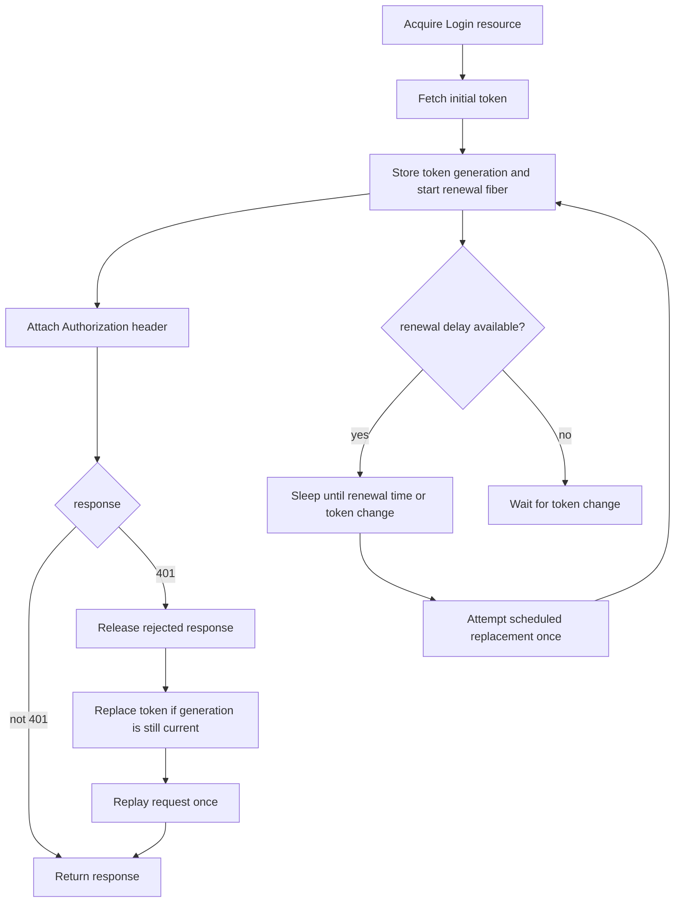

# HTTP client utilities

The HTTP module adds authentication and middleware to http4s clients. It focuses on four concerns:

- OAuth 2.0 client-credentials and authorization-code authentication.
- Salesforce password-grant authentication and instance routing.
- Policy-driven request retries.
- Stateful cookie management backed by `java.net.CookieManager`.

All APIs wrap an existing `org.http4s.client.Client`. The application remains responsible for
choosing and configuring the underlying client implementation, connection pool, TLS, logging,
metrics, and tracing.

## Contents

- [Dependency](#dependency)
- [Authentication](#authentication)
  - [Choose a flow](#choose-a-flow)
  - [Client credentials](#client-credentials)
  - [Authorization code](#authorization-code)
  - [Salesforce password grant](#salesforce-password-grant)
  - [Token lifecycle](#token-lifecycle)
  - [Concurrent renewal](#concurrent-renewal)
- [Middleware](#middleware)
  - [Default HTTP retries](#default-http-retries)
  - [Reckless retries](#reckless-retries)
  - [Cookie management](#cookie-management)
- [OAuth wire format](#oauth-wire-format)
- [Security and resource safety](#security-and-resource-safety)
- [Source map and validation](#source-map-and-validation)

## Dependency

Add the HTTP module and an http4s client implementation to the application:

```scala
libraryDependencies ++= Seq(
  "com.github.chenharryhua" %% "nj-http" % "<version>",
  "org.http4s" %% "http4s-ember-client" % "<compatible-version>"
)
```

The examples below use Ember, but any `Resource[F, Client[F]]` can supply the authentication and
business clients.

## Authentication

Authentication functions live in `com.github.chenharryhua.nanjin.http.client.auth`. Each function
returns a `Login[F]`. Calling `login` eagerly obtains the initial token and returns a resource-scoped
client that attaches that token to outgoing requests.

Use separate authentication and business clients when their middleware differs. In particular, the
authentication client must not log form bodies that contain secrets.

### Choose a flow

| Flow | Constructor | Client authentication | Initial grant | Renewal |
| --- | --- | --- | --- | --- |
| Client credentials, POST | `auth.postClientCredentials` | `client_id` and `client_secret` in the form body | `client_credentials` | Scheduled refresh when possible; otherwise a fresh credentials exchange. A `401` always triggers a fresh credentials exchange |
| Client credentials, Basic | `auth.basicClientCredentials` | HTTP Basic header | `client_credentials` | Same token strategy as the POST variant |
| Authorization code, POST | `auth.postAuthorizationCode` | `client_id` and `client_secret` in the form body | Single-use `authorization_code` | Requires a server-supplied `refresh_token` |
| Authorization code, Basic | `auth.basicAuthorizationCode` | HTTP Basic header | Single-use `authorization_code` | Same token strategy as the POST variant |
| Salesforce password grant | `Salesforce(...)` | Credentials in the form body | Salesforce `password` grant | Repeats the password grant on schedule or after rejection |

The Basic variants URL-encode the client identifier and secret before constructing the HTTP Basic
credentials. Use the authentication style supported by the token server.

### Client credentials

The client-credentials flow is suitable for service-to-service authentication without user consent.
Acquire the authenticated client once and share it for the application lifetime rather than
performing a token exchange per request.

```scala
import cats.data.NonEmptyList
import cats.effect.{IO, Resource}
import com.github.chenharryhua.nanjin.common.Secret
import com.github.chenharryhua.nanjin.http.client.auth
import com.github.chenharryhua.nanjin.http.client.auth.ClientCredentials
import org.http4s.client.Client
import org.http4s.ember.client.EmberClientBuilder
import org.http4s.implicits.*

val authenticationClient: Resource[IO, Client[IO]] =
  EmberClientBuilder.default[IO].build

val businessClient: Resource[IO, Client[IO]] =
  EmberClientBuilder.default[IO].build

val credentials = ClientCredentials(
  auth_endpoint = uri"https://identity.example.com/oauth/token",
  client_id = "orders-service",
  client_secret = Secret(sys.env("OAUTH_CLIENT_SECRET")),
  scope = Some(NonEmptyList.of("orders:read", "orders:write"))
)

val authenticatedClient: Resource[IO, Client[IO]] =
  auth
    .basicClientCredentials(authenticationClient, credentials)
    .login(businessClient)

val responseBody: IO[String] =
  authenticatedClient.use(
    _.expect[String](uri"https://api.example.com/orders")
  )
```

Use `postClientCredentials` instead when the server expects client-secret-post authentication. That
variant places both the client identifier and secret in the form body.

A positive `expires_in` response schedules renewal before expiry. If the token includes a
`refresh_token`, scheduled renewal uses it and retains the previous refresh token when the refresh
response omits a replacement. Without a refresh token, scheduled renewal performs another
client-credentials exchange. Missing, zero, or negative `expires_in` disables scheduled renewal;
reactive replacement after `401 Unauthorized` remains enabled.

### Authorization code

The application must first obtain an authorization code through the user's browser-facing consent
flow. This module exchanges that code; it does not implement the authorization redirect or callback
endpoint.

```scala
import com.github.chenharryhua.nanjin.common.Secret
import com.github.chenharryhua.nanjin.http.client.auth.AuthorizationCode

val authorizationCode = AuthorizationCode(
  auth_endpoint = uri"https://identity.example.com/oauth/token",
  client_id = "web-application",
  client_secret = Secret(sys.env("OAUTH_CLIENT_SECRET")),
  code = Secret(sys.env("OAUTH_AUTHORIZATION_CODE")),
  redirect_uri = "https://app.example.com/oauth/callback"
)

val authorizedClient: Resource[IO, Client[IO]] =
  auth
    .postAuthorizationCode(authenticationClient, authorizationCode)
    .login(businessClient)
```

An authorization-code `Login` permits one resource acquisition. A second acquisition fails even if
the first token exchange failed, because the server may already have consumed the code.

Authorization-code renewal requires a `refresh_token`. Scheduled renewal also requires a positive
`expires_in`. If a business request receives `401 Unauthorized` and the token has no refresh token,
the request fails and the user must authorize again; the code cannot be exchanged a second time.

Use `basicAuthorizationCode` when the token endpoint expects client-secret-basic authentication.
That variant omits `client_id` and `client_secret` from both authorization-code and refresh forms.

### Salesforce password grant

`Salesforce.PasswordGrant` is intended for trusted server-side applications. The login exchanges the
connected-app and user credentials, then rewrites business requests to the `instance_url` returned
by Salesforce while preserving their path, query, and fragment.

```scala
import com.github.chenharryhua.nanjin.http.client.auth.Salesforce

import scala.concurrent.duration.*

val salesforceCredentials = Salesforce.PasswordGrant(
  auth_endpoint = uri"https://login.salesforce.com/services/oauth2/token",
  client_id = sys.env("SALESFORCE_CLIENT_ID"),
  client_secret = Secret(sys.env("SALESFORCE_CLIENT_SECRET")),
  username = sys.env("SALESFORCE_USERNAME"),
  password = Secret(sys.env("SALESFORCE_PASSWORD"))
)

val salesforceClient: Resource[IO, Client[IO]] =
  Salesforce(
    authenticationClient,
    salesforceCredentials,
    expiresIn = 2.hours
  ).login(businessClient)

val availableVersions: IO[String] =
  salesforceClient.use(
    _.expect[String](uri"/services/data")
  )
```

Salesforce does not return `expires_in`. The three-argument constructor schedules early renewal when
the supplied lifetime is at least one second. A shorter or non-positive lifetime, or the two-argument
constructor, disables scheduled renewal. A rejected token still triggers a new password-grant
exchange.

### Token lifecycle



The authenticated client has these lifecycle rules:

- Initial acquisition fetches a token before returning the client.
- A background fiber schedules proactive replacement only when the flow supplies a renewal delay.
- A scheduled token request is attempted once. On failure, the scheduler waits until another path
  replaces the token; configure retry and observability middleware on the authentication client when
  required.
- A business response with `401 Unauthorized` triggers token replacement and one replay. A second
  `401` is returned without another renewal loop.
- The rejected response is released before the replay is acquired, so a bounded connection pool can
  supply the retry.
- Closing the login resource stops the renewal fiber and releases its authentication client. The
  `login(Resource[F, Client[F]])` overload also releases the supplied business-client resource.

Authentication replay applies to every HTTP method, including `POST`. Request bodies must be
repeatable, and the resource server should reject invalid authentication before performing business
side effects.

### Concurrent renewal

One authenticated client owns one token state and one renewal mutex. Every successful replacement
increments a generation number. A scheduled renewal and one or more concurrent `401` responses may
race, but only the first replacement for the current generation performs a token exchange. Later
contenders observe the newer generation and reuse its token instead of overwriting it.

When many requests reject the same token concurrently, they share one replacement. A request that
received a stale `401` after another request already renewed also reuses the current token. Acquire
one login resource and share its client to preserve this coordination; separate acquisitions create
separate token caches and renewal fibers.

## Middleware

Middleware functions live in `com.github.chenharryhua.nanjin.http.client.middleware` and transform a
`Client[F]` without changing its response-resource contract.

### Default HTTP retries

`httpRetry` retries request-effect failures while policy ticks remain. For completed HTTP responses,
it uses http4s's `RetryPolicy.defaultRetriable`, which selects retriable statuses only for methods
that policy considers idempotent.

```scala
import com.github.chenharryhua.nanjin.http.client.middleware.httpRetry

import java.time.ZoneId
import scala.concurrent.duration.*

val retryingClient: Resource[IO, Client[IO]] =
  businessClient.map(
    httpRetry[IO](
      ZoneId.systemDefault(),
      _.fixedDelay(250.millis).repeat.limited(3)
    )
  )
```

The `Policy` controls retry opportunities and delays. An empty policy performs one request with no
retry. When the policy is exhausted, the middleware returns the last response or raises the last
request error.

If a retriable response has `Retry-After`, the effective delay is the greater of the policy delay and
the server's requested delay. Both delta-seconds and HTTP-date forms are supported; a date in the
past contributes zero delay. The previous response resource is released before the next attempt.

A custom predicate controls completed responses. Raised request errors advance the retry policy
without consulting that predicate:

```scala
import org.http4s.{Method, Request, Response, Status}

val retryServerErrors =
  (request: Request[IO], result: Either[Throwable, Response[IO]]) =>
    request.method == Method.GET &&
      result.exists(_.status == Status.InternalServerError)

val customRetryClient: Resource[IO, Client[IO]] =
  businessClient.map(
    httpRetry[IO](
      ZoneId.systemDefault(),
      _.fixedDelay(250.millis).repeat.limited(3),
      retryServerErrors
    )
  )
```

### Reckless retries

`recklessHttpRetry` uses http4s's `RetryPolicy.recklesslyRetriable`, which can retry
non-idempotent methods such as `POST`:

```scala
import com.github.chenharryhua.nanjin.http.client.middleware.recklessHttpRetry

val tokenClientWithRetries: Resource[IO, Client[IO]] =
  authenticationClient.map(
    recklessHttpRetry[IO](
      ZoneId.systemDefault(),
      _.fixedDelay(500.millis).repeat.limited(2)
    )
  )
```

Use this only when repeating the request is acceptable. It broadens response retries to
non-idempotent methods; raised request errors are already policy-driven in both retry variants. A
lost response does not prove that the server skipped the first attempt. Retrying token exchanges can
also be unsafe for single-use authorization codes.

Authentication helpers do not retry token-endpoint calls themselves. Apply retry middleware to the
authentication client when the token server and grant semantics permit it.

### Cookie management

`cookieBox` reads matching cookies before each request and stores every `Set-Cookie` header after a
response arrives:

```scala
import com.github.chenharryhua.nanjin.http.client.middleware.cookieBox

import java.net.CookieManager

val cookieManager = new CookieManager()

val cookieClient: Resource[IO, Client[IO]] =
  businessClient.map(cookieBox[IO](cookieManager))
```

Reuse the same `CookieManager` for requests that belong to one cookie session. Its store isolates
cookies by URI and supports multiple cookies. The Java default in-memory cookie manager is safe for
concurrent fibers, though heavy contention still serializes access internally.

`cookieBox` suspends store reads and writes in `F` and preserves the wrapped client's response
finalizers. The caller owns the `CookieManager` and decides when to clear or replace its store.

## OAuth wire format

The following names are HTTP or JSON wire format and must remain stable.

### Token request forms

| Flow | Form fields |
| --- | --- |
| Client credentials, POST | `grant_type=client_credentials`, `client_id`, `client_secret`, optional `scope` |
| Client credentials, Basic | `grant_type=client_credentials`, optional `scope`; credentials are in the Basic header |
| Authorization code, POST | `grant_type=authorization_code`, `client_id`, `client_secret`, `code`, `redirect_uri` |
| Authorization code, Basic | `grant_type=authorization_code`, `code`, `redirect_uri`; credentials are in the Basic header |
| Generic refresh, POST | `grant_type=refresh_token`, `refresh_token`, `client_id`, `client_secret` |
| Generic refresh, Basic | `grant_type=refresh_token`, `refresh_token`; credentials are in the Basic header |
| Salesforce password | `grant_type=password`, `client_id`, `client_secret`, `username`, `password` |

Client-credentials scopes are joined with spaces in the `scope` form field. Authorization-code
scopes belong to the earlier user-authorization request and are not repeated during token exchange.

### Token responses

Generic OAuth token responses decode these JSON fields:

| Field | Type | Notes |
| --- | --- | --- |
| `token_type` | `String` | Used as the authorization scheme |
| `access_token` | `String` | Attached to business requests |
| `expires_in` | `Option[Long]` | Lifetime in seconds; optional under the supported protocol behavior |
| `refresh_token` | `Option[String]` | Optional; valid client-credentials responses commonly omit it |

Salesforce token responses require `access_token`, `instance_url`, and `token_type`. They also decode
the optional fields `id`, `issued_at`, and `signature`. `UriJsonCodec` encodes and decodes an http4s
`Uri` as a JSON string and is used for `instance_url`.

## Security and resource safety

- Load client secrets, authorization codes, usernames, and passwords from a secret manager or the
  runtime environment. Do not commit them to source control.
- `Secret` masks ordinary Scala rendering, but it does not redact HTTP requests. POST-authenticated
  OAuth and Salesforce forms contain secrets in their bodies.
- Use TLS for token and business endpoints outside isolated local tests.
- Disable authentication-client body logging for POST credential flows. Redact the `Authorization`
  header when logging Basic credentials or bearer tokens.
- Configure retries separately for authentication and business clients. Do not apply reckless retry
  globally.
- Hold the authenticated `Client` through `Resource.use` or compose it into the application's main
  resource graph. Do not call `allocated` without managing its finalizer.
- Consume every response through `use`, `expect`, `status`, or another http4s operation that closes
  the response resource.
- Keep request entities repeatable when authentication replay or retry middleware can resend them.

## Source map and validation

| Area | Source |
| --- | --- |
| Login resource and token coordinator | [`TokenAuthClient.scala`](../src/main/scala/com/github/chenharryhua/nanjin/http/client/auth/TokenAuthClient.scala) |
| Shared OAuth token exchange | [`OAuthTokenAuth.scala`](../src/main/scala/com/github/chenharryhua/nanjin/http/client/auth/OAuthTokenAuth.scala) |
| Client credentials | [`ClientCredentials.scala`](../src/main/scala/com/github/chenharryhua/nanjin/http/client/auth/ClientCredentials.scala) |
| Authorization code | [`AuthorizationCode.scala`](../src/main/scala/com/github/chenharryhua/nanjin/http/client/auth/AuthorizationCode.scala) |
| Public OAuth constructors | [`authentication.scala`](../src/main/scala/com/github/chenharryhua/nanjin/http/client/auth/authentication.scala) |
| Salesforce | [`Salesforce.scala`](../src/main/scala/com/github/chenharryhua/nanjin/http/client/auth/Salesforce.scala) |
| URI JSON codec | [`UriJsonCodec.scala`](../src/main/scala/com/github/chenharryhua/nanjin/http/client/auth/UriJsonCodec.scala) |
| Retry middleware | [`httpRetry.scala`](../src/main/scala/com/github/chenharryhua/nanjin/http/client/middleware/httpRetry.scala) |
| Cookie middleware | [`cookieBox.scala`](../src/main/scala/com/github/chenharryhua/nanjin/http/client/middleware/cookieBox.scala) |

From the repository root:

```shell
sbt 'http / Test / compile'
sbt 'http / test'
```
